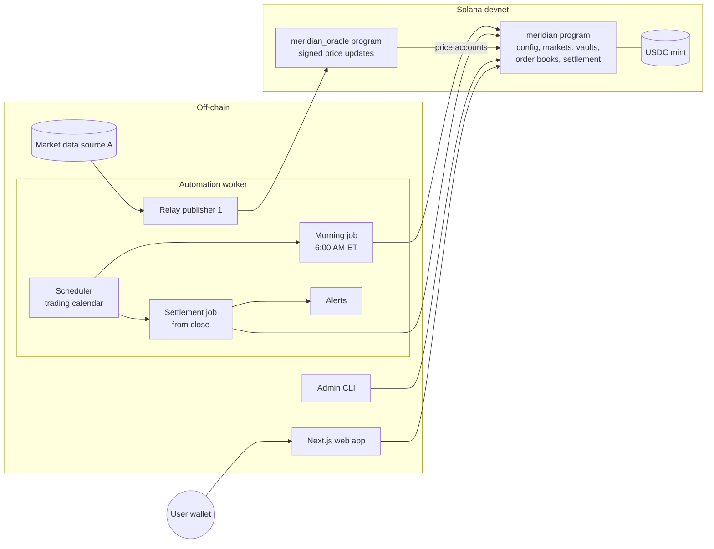

# Meridian Architecture

Meridian is a non-custodial app for trading same-day binary outcome contracts on the closing prices of seven large-cap US stocks (AAPL, MSFT, GOOGL, AMZN, NVDA, META, TSLA). Each contract asks "Will [TICKER] close at or above [STRIKE] today?" A Yes token pays $1.00 USDC if it does and a No token pays $1.00 USDC if it doesn't, so Yes + No always equals $1.00. Markets are created automatically each morning, trade on an on-chain order book during market hours, settle automatically from a price oracle after the close, and pay winners from a fully collateralized vault.

This document describes how Meridian is built.

---

## 1. Summary of key choices

| Area | Choice |
| --- | --- |
| Chain | Solana. Devnet for all development and the demo. No mainnet, no real funds. |
| On-chain program | Rust + Anchor |
| Order book | Our own minimal CLOB inside the program, one book per strike (Yes vs USDC) |
| Price oracles | Two oracle slots with a plug-and-play adapter. The MVP and demo run our own **Meridian Price Relay** in slot 1 and leave slot 2 **disabled** until a second source is available. Pyth, Chainlink Data Streams or a second relay source can be plugged into either slot by configuration. |
| Closing price | Official close → exact 4:00:00 PM price → linear interpolation between the nearest prices on each side of 4:00:00 PM |
| Settlement | First valid oracle answer wins, on a timed escalation schedule. Admin fallback can propose from +10 min and finalize at +60 min. |
| Pair exit | New **Merge** instruction: 1 Yes + 1 No → $1.00 USDC at any time |
| Strikes | Fixed ±3%, ±6%, ±9% plus the rounded previous close, rounded to $10 and deduplicated |
| Morning job | Starts 6:00 AM ET, all markets created by 8:00 AM ET |
| Frontend | TypeScript, React, Next.js, Solana wallet adapter |
| Automation | TypeScript / Node.js worker in the same repo |
| Hosting | Railway for the web app and the automation worker |

---

## 2. System overview



### Components

| Component | Path | Responsibility |
| --- | --- | --- |
| `meridian` program | `programs/meridian` | Config, strike markets, Yes/No mints, USDC vaults, order books, mint/merge/redeem, settlement, admin override, pause |
| `meridian_oracle` program | `programs/meridian_oracle` | Stores signed price updates published by the Meridian Price Relay, in a format modeled on Pyth's price update accounts |
| SDK | `packages/sdk` | TypeScript client generated from the Anchor IDLs, transaction builders for the four trade paths, PDA helpers, and shared closing-price and strike math |
| Price providers | `packages/price-providers` | Off-chain `PriceProvider` interface and implementations: relay data sources (A, B), Pyth, Chainlink Data Streams |
| Automation worker | `services/automation` | Scheduler, morning job, settlement job with escalation, relay publishers, alerts |
| Web app | `app` | Landing, Markets, Trade, Portfolio and History pages |
| Admin CLI | `services/automation/src/cli` | Initialize config, add strike, propose and finalize admin price, pause and unpause |
| Scripts | `scripts` | Devnet deploy, config bootstrap, and the full lifecycle demo |
| Integration tests | `tests` | Anchor tests on a local validator |

---

## 3. On-chain design (`meridian` program)

### 3.1 Units

- **USDC** has 6 decimals. $1.00 = `1_000_000` base units.
- **Yes and No tokens** have 6 decimals, so 1 token = `1_000_000` base units and pays at most $1.00. Orders are placed in whole tokens (lot size `1_000_000`).
- **Order prices** are in cents, from 1 to 99 (tick = $0.01). A Yes price of 65 means $0.65, and the implied No price is $0.35.
- **Strike and oracle prices** are signed integers with an exponent, as Pyth uses (`price × 10^expo`). Strikes are stored with the same exponent as the configured price sources, so comparisons never mix scales.

### 3.2 Accounts

| Account | Seeds | Key fields |
| --- | --- | --- |
| `Config` | `["config"]` | `admin`, `usdc_mint`, `tickers[7]`, `oracle_slots[2]` (see §5), `max_staleness_secs` (300), `max_conf_bps`, `admin_propose_delay_secs` (600), `admin_finalize_delay_secs` (3600), `paused`, `demo_mode` |
| `Market` | `["market", ticker, trading_day (YYYYMMDD), strike]` | `ticker`, `trading_day`, `strike`, `strike_expo`, `close_ts`, `yes_mint`, `no_mint`, `vault`, `book`, `pairs_outstanding`, `status` (`Open`, `Settled`), `outcome` (`Yes`, `No`), `settle_price`, `settle_source` (oracle slot or admin), `pending_admin_price`, `pending_admin_at`, `created_at` |
| Yes mint, No mint | `["yes", market]`, `["no", market]` | Mint authority is the `Market` PDA. No freeze authority. |
| Vault | `["vault", market]` | USDC token account owned by the `Market` PDA |
| `OrderBook` | `["book", market]` | Zero-copy. Fixed-capacity bid and ask arrays, next order sequence number, base (Yes) and quote (USDC) escrow vaults |
| `OpenOrders` | `["oo", market, owner]` | A trader's resting order IDs and their unsettled (free) Yes and USDC balances, credited on fills |

`close_ts` is the market close as a Unix timestamp. The automation worker computes it from the exchange calendar and writes it at market creation, so DST and early-close days (1:00 PM ET) are handled without any calendar logic on-chain. Every settlement time rule below is relative to `close_ts`.

### 3.3 Instructions

| Instruction | Who | Behavior |
| --- | --- | --- |
| `initialize_config` | Admin, once | Sets admin, USDC mint, tickers, oracle slots, thresholds, delays |
| `update_config` | Admin | Changes oracle slots, thresholds or relay signers. Cannot change a market already created. |
| `create_strike_market` | Admin or automation authority | Creates one `Market`, its Yes/No mints, vault, `OrderBook` and escrow vaults. One strike per call, not batched. Fails if the PDA already exists, which makes the morning job idempotent. |
| `add_strike` | Admin | Same as `create_strike_market`, allowed intraday before `close_ts` |
| `mint_pair(n)` | Anyone | Transfers `n` USDC into the vault, mints `n` Yes and `n` No to the caller. Blocked when paused or after `close_ts`. |
| `merge_pair(n)` | Anyone | Burns `n` Yes and `n` No from the caller and pays `n` USDC from the vault. Allowed before settlement, including while paused, so users can always exit fully hedged positions. |
| `place_order(side, kind, price, qty)` | Anyone | `side`: `Bid` (buy Yes) or `Ask` (sell Yes). `kind`: `Limit` (rests the remainder), `Market` (matches up to `price` as a worst-price limit, never rests), `PostOnly`. Escrows USDC for bids and Yes for asks, matches by price-time priority, and credits fills to both sides' `OpenOrders`. Blocked when paused or at or after `close_ts`. |
| `cancel_order(order_id)` | Order owner | Removes a resting order and returns its escrow to the owner's `OpenOrders` free balance. Allowed while paused and after close. |
| `settle_funds` | `OpenOrders` owner | Withdraws free Yes and USDC balances to the owner's token accounts |
| `settle_market` | Anyone (normally the automation worker) | Applies the closing price rule (§4) to price accounts from one configured oracle slot and writes the outcome. Requires `now ≥ close_ts`. Overrides any pending admin price. Emits `MarketSettled`, and `AdminPriceMismatch` if a pending admin price differed. |
| `propose_admin_price(price)` | Admin | Allowed at `close_ts + 600` or later. Stores a pending price. It is not final. Can be replaced by a later proposal. |
| `finalize_admin_settle` | Anyone | Allowed at `close_ts + 3600` or later, if a pending price exists and the market is still open. Writes the outcome from the pending price. |
| `redeem(yes_amount, no_amount)` | Anyone | After settlement only. Burns the given tokens and pays $1.00 per winning token and $0 per losing token from the vault. Never expires. |
| `pause` / `unpause` | Admin | Halts `mint_pair` and `place_order` across all markets |

After settlement, users cancel any resting orders and call `settle_funds` to get their escrow back before redeeming. The web app bundles these steps into one transaction where it can.

### 3.4 The four trade paths

All four map onto one book per strike. The SDK builds each as **one transaction**, so the user signs once and the steps are atomic.

| User action | Instructions in the transaction |
| --- | --- |
| Buy Yes | `place_order(Bid, Market or Limit, price, qty)` → `settle_funds` |
| Sell Yes | `place_order(Ask, Market or Limit, price, qty)` → `settle_funds`. The seller picks Market (sell now at the best bid) or Limit (post a price and wait). |
| Buy No | `mint_pair(qty)` → `place_order(Ask, Market or Limit, 100 − no_price, qty)` → `settle_funds`. With a limit order the user holds both tokens until the Yes ask fills. |
| Sell No | `place_order(Bid, Market, 100 − no_price, qty)` → `settle_funds` → `merge_pair(filled)` |

### 3.5 Position constraint

A user must not hold Yes and No for the same strike as a resting position created from the trading UI. This is enforced in the web app and the SDK transaction builders: they read the wallet's Yes and No balances and refuse Buy Yes while No is held, or Buy No while Yes is held, prompting the user to close first.

It is not enforced on-chain. Both Buy No (limit) and Sell No legitimately pass through holding both tokens, and SPL tokens can be transferred between wallets, so an on-chain check would block valid flows without preventing the state.

### 3.6 Invariants

The program checks these after every state-changing instruction, and the test suite asserts them.

| ID | Invariant |
| --- | --- |
| INV-1 | Before settlement: `vault balance == Yes supply == No supply == pairs_outstanding × 1_000_000` |
| INV-2 | After settlement: `vault balance ≥ winning-side supply × 1_000_000`, and each redeem pays exactly `1_000_000` per winning token |
| INV-3 | Yes payout + No payout = $1.00 for every possible settlement price |
| INV-4 | Yes and No are minted only by `mint_pair`, and burned only by `merge_pair` and `redeem` (mint authority is the market PDA; order book escrow moves tokens but never mints or burns) |
| INV-5 | Once `status == Settled`, `outcome` and `settle_price` never change |
| INV-6 | There are no fees in the MVP. If fees are added, they go to a separate fee account, never the vault. |

### 3.7 Order book limits

The book is a zero-copy account with a fixed capacity per side (start with 128 orders per side and tune against Solana's account size and compute limits). Matching is capped at a fixed number of fills per `place_order` call to stay within the compute budget. A market order that would exceed the cap fills partially and returns the rest. Order IDs combine price and a sequence number, so sorting gives price-time priority.

---

## 4. Settlement

### 4.1 Closing price rule

`settle_market` receives price accounts from one oracle slot and accepts exactly one of these shapes, checked in this order:

1. **Official close.** One update flagged `OfficialClose` for this ticker and trading day.
2. **Exact timestamp.** One regular-session update with `publish_time == close_ts`.
3. **Linear interpolation.** Two regular-session updates `(P₁, t₁)` and `(P₂, t₂)` with `close_ts − 300 ≤ t₁ < close_ts < t₂ ≤ close_ts + 300`.

For each update used, the program checks that it belongs to the market's ticker, that the price is positive, and that `conf / price ≤ max_conf_bps`. Updates outside the regular session are rejected, which keeps after-hours trades out.

Comparison against the strike uses exact integer math with no division, so a price that lands on the strike can never round the wrong way:

- Shapes 1 and 2: Yes wins if `P ≥ strike`.
- Shape 3: Yes wins if `P₁ × (t₂ − t₁) + (P₂ − P₁) × (close_ts − t₁) ≥ strike × (t₂ − t₁)`. Use `i128`.

The stored `settle_price` is the interpolated value, rounded to the price exponent, for display only. The outcome comes from the exact comparison.

The same function lives in `packages/sdk` for the web app and the worker, and both implementations are tested against one shared set of fixtures.

### 4.2 Escalation schedule

Times are relative to `close_ts`. On a normal day `close_ts` is 4:00 PM ET.

| Time | Worker action | On-chain rule |
| --- | --- | --- |
| +0:00 | Poll oracle slot 1 every 30 s. Call `settle_market` as soon as it has a valid shape. | `settle_market` allowed from `close_ts` |
| +0:04 | No valid price yet: also poll slot 2 every 30 s. Skipped while slot 2 is disabled. | — |
| +0:10 | No valid price yet: **first admin alert**. Switch to staggered polling: each slot once every 3 min, offset by 1 min (slot 1 at +0:11, +0:14, …; slot 2 at +0:12, +0:15, …). With slot 2 disabled, slot 1 is polled every 3 min. | `propose_admin_price` allowed |
| +0:50 | No valid price yet: **second admin alert** | — |
| +1:00 | If an admin price is pending, call `finalize_admin_settle`. Otherwise keep staggered polling until an oracle answers or the admin proposes, then settle immediately. | `finalize_admin_settle` allowed |

The first valid answer from either slot settles the market and stops all polling for it. An oracle answer before finalization always beats a pending admin price. When it replaces one with a different value, the program emits `AdminPriceMismatch` and the worker logs both values and alerts the admin.

The admin may only propose the exchange's official published closing price. The pending and final values are both on-chain and public.

---

## 5. Price sources (plug and play)

### 5.1 The abstraction

Each of the two **oracle slots** in `Config` holds:

- `kind`: `Disabled`, `MeridianRelay`, `Pyth` or `ChainlinkDataStreams`
- `kind: Disabled` means the slot is skipped entirely
- for `MeridianRelay`: the relay signer public key for that slot
- for `Pyth`: the 7 feed IDs, and the minimum verification level
- for `ChainlinkDataStreams`: the 7 stream IDs and the verifier program ID

**On-chain**, `settle_market` takes a slot index and its price accounts as remaining accounts. A `price_adapter` module turns any of the three kinds into one `NormalizedPrice`:

```rust
pub struct NormalizedPrice {
    pub price: i64,          // price × 10^expo
    pub conf: u64,           // same scale as price
    pub expo: i32,
    pub publish_time: i64,   // unix seconds
    pub session: Session,    // Regular | OutsideRegular
    pub official_close: bool,
}
```

The closing price rule (§4.1) only ever sees `NormalizedPrice`, so it is identical whichever oracle is configured.

**Off-chain**, the worker uses one interface per slot:

```ts
interface PriceProvider {
  name: string
  // Fetch and post (or prepare) the updates for this ticker's close.
  // Returns the accounts or instructions settle_market needs, or null if no valid shape exists yet.
  prepareClose(ticker: Ticker, closeTs: number): Promise<SettlementInputs | null>
  // Previous close for strike calculation (off-chain read is allowed for this).
  previousClose(ticker: Ticker, tradingDay: string): Promise<number>
}
```

Switching a slot from the relay to Pyth or Chainlink is a config change, `update_config` plus env vars, with no code change in the settlement logic.

### 5.2 Meridian Price Relay (MVP and demo)

Our own oracle. Each relay publisher has its own signer key and its own market-data source, so if a second relay is added later the two slots stay independent.

- **`meridian_oracle` program:** a `publish_price` instruction that only accepts a transaction signed by a registered relay signer, and writes a `PriceUpdate` account (`["price", signer, ticker, publish_time]`) with `price`, `conf`, `expo`, `publish_time`, `session`, `official_close`. Accounts are append-only: an existing `(signer, ticker, publish_time)` can't be overwritten.
- **Relay publisher** (in the worker): after `close_ts`, it asks its data source for:
  1. the **official daily close** if the source provides one, published with `official_close = true`;
  2. otherwise, the last regular-session price at or before `close_ts` and the first price after it, both with their timestamps.
- **Confidence:** half the bid-ask spread if the source provides bid and ask; otherwise half the high-low range of the 1-minute bar the price came from.
- **Data source A:** Chainlink Candlestick API (1-minute OHLC, all 7 tickers available, credentials already set up). The 15:59 bar close is published with `publish_time = close_ts − 1`, and the 16:00 bar open with `publish_time = close_ts + 1`, as a regular-session pair for interpolation. Resolution is 1 minute, which is coarser than per-second data. This is an accepted MVP limitation.
- **Second source (not in the MVP):** slot 2 ships as `Disabled`. Adding a second source later means writing one `RelaySource` implementation, giving it its own signer key, and switching slot 2 to `MeridianRelay` (or to `Pyth` / `ChainlinkDataStreams`). Criteria for a second stock-data source: consolidated US prices, not a single venue; at most about 1 minute of delay; ideally an official daily close field; terms that allow publishing a derived settlement value.

The trust trade-off: the relay is a centralized oracle that users must trust not to publish false prices. In the MVP there is one data source and one signer. This is mitigated by public on-chain records of every published value, the admin fallback and mismatch alert, and the documented path to a second source, Pyth or Chainlink. The README and the risks note must state this plainly.

### 5.3 Pyth (documented, enabled by config)

Not used in the demo because US equity access costs about $500/month. How it would be used:

- **Feeds:** `Equity.US.<TICKER>/USD`. The schedule is regular hours only (09:30–16:00 ET, with holidays and half days). Feed IDs:

  | Ticker | Feed ID |
  | --- | --- |
  | AAPL | `49f6b65cb1de6b10eaf75e7c03ca029c306d0357e91b5311b175084a5ad55688` |
  | MSFT | `d0ca23c1cc005e004ccf1db5bf76aeb6a49218f43dac3d4b275e92de12ded4d1` |
  | GOOGL | `5a48c03e9b9cb337801073ed9d166817473697efff0d138874e0f6a33d6d5aa6` |
  | AMZN | `b5d0e0fa58a1f8b81498ae670ce93c872d14434b72c364885d4fa1b257cbb07a` |
  | NVDA | `b1073854ed24cbc755dc527418f52b7d271f6cc967bbf8d8129112b18860a593` |
  | META | `78a3e3b8e676a8f73c439f5d749737034b139bbbe899ba5775216fba596607fe` |
  | TSLA | `16dad506d7db8da01c87581c87ca897a012a153557d4d578c3b9c9e1bc0632f1` |
- **Off-chain:** the worker calls Hermes `GET /v2/updates/price/{publish_time}?ids[]=…` with `Authorization: Bearer $PYTH_ACCESS_TOKEN` for times just before and after `close_ts`, and posts the signed updates through the Pyth Solana receiver program (same address on devnet and mainnet). Pyth does not keep equity accounts fresh on Solana itself, so we post our own.
- **On-chain:** the adapter reads the receiver's price update accounts, requires full verification, and maps `price`, `conf`, `exponent` and `publish_time` to `NormalizedPrice`. Session comes from the publish time falling inside regular hours. Pyth does not label an official close.
- **Prerequisite:** a Pyth plan entitled to US equities. The current key is valid but returns `Not entitled … asset type 'equity'`.

### 5.4 Chainlink Data Streams (documented, enabled by config)

Not used in the demo because the account has no streams assigned and no testnet credentials. How it would be used:

- **Streams:** US equity streams in the **RWA Advanced (v11)** report schema, which Chainlink recommends for US equities. It includes `mid`, `bid`, `ask`, `lastTradedPrice`, `marketStatus` and `lastSeenTimestampNs`.
- **Off-chain:** the worker calls `GET /api/v1/reports?feedID=…&timestamp=…` (HMAC-signed headers using `CHAINLINK_DATA_STEAMS_USERNAME` and `CHAINLINK_HMAC_SECRET`; set a `User-Agent` header, which the API requires) for timestamps just before and after `close_ts`, and passes each `fullReport` to `settle_market`.
- **On-chain:** the adapter verifies each report by CPI to the Chainlink verifier program and decodes it. `price = lastTradedPrice` if present, else `mid`; `conf = (ask − bid) / 2`; `session = Regular` only when `marketStatus` is regular hours. No official close label.
- **Prerequisites:** US equity streams assigned to the account, testnet credentials, and the devnet verifier program ID.

---

## 6. Automation worker

One long-running Node.js process. All times are America/New_York, from a trading calendar module that knows weekends, NYSE holidays and early closes. The calendar data is checked into the repo and covered by tests.

### Morning job (trading days, 6:00 AM ET, must finish by 8:00 AM ET)

1. For each ticker, get the previous close from slot 1's provider, falling back to slot 2 when it is enabled.
2. Compute strikes: `round_to_10(prev × (1 ± p))` for p ∈ {3%, 6%, 9%}, plus `round_to_10(prev)`, then deduplicate and sort.
3. Call `create_strike_market` once per strike, sequentially. Existing markets are skipped (idempotent).
4. Log each result. Retry failures with exponential backoff. If any ticker is still incomplete at 7:30 AM ET, alert.

### Settlement job

Starts at each day's `close_ts` and runs the escalation schedule in §4.2 for every open market of the day. It settles markets independently, so one ticker's oracle trouble doesn't hold up the others.

### Alerts

Alerts go to a webhook (`ALERT_WEBHOOK_URL`, for example a chat channel) and to structured logs: morning job failures, the +10 and +50 minute settlement alerts, `AdminPriceMismatch`, and any invariant check failure reported by the program.

### Demo mode

The lifecycle demo can't wait for a real 4:00 PM close. When `Config.demo_mode` is on (devnet only), the admin can create a market with a custom `close_ts` a few minutes in the future. The demo relay publishes a **recorded real close from a past trading day** for that ticker, re-stamped to the demo `close_ts` and labeled as replayed data in its logs. `demo_mode` must be off in any non-demo deployment, and the UI shows a "Demo market" badge on such markets.

---

## 7. Web app

Next.js (App Router), TypeScript, Solana wallet adapter, and the Anchor client from `packages/sdk`.

| Page | Contents |
| --- | --- |
| Landing | What Meridian is, live prices, connect-wallet button |
| Markets | Grid of the 7 tickers with live price and number of active contracts |
| Trade | Strike list for one ticker; the order book in two views (Yes view, and No view as `100 − price` with sides swapped); the Buy Yes / Sell Yes / Buy No / Sell No panel with Market or Limit; a countdown to `close_ts`; and the payoff line "You pay $X. You win $1.00 if [TICKER] closes above [STRIKE]." |
| Portfolio | Positions with entry price, current price and P&L; settled outcomes; Redeem; and a "close out orders and redeem" action |
| History | The user's fills, derived from program events |

- **Real-time:** websocket `accountSubscribe` on the open market's `OrderBook` and `Market` accounts, with polling as a fallback. Live stock prices come from the worker's read-only price endpoint, which proxies data source A. Wallets and the chain never depend on it.
- **History and P&L:** the program emits `OrderFilled`, `PairMinted`, `PairMerged`, `Redeemed` and `MarketSettled` events. The app reads the user's transaction history (`getSignaturesForAddress` on their `OpenOrders` and token accounts), decodes the events, and computes average entry price and realized P&L client-side. There is no database in the MVP.
- **USDC on devnet:** Circle's devnet USDC mint (users fund wallets from Circle's faucet). Local tests use a mock USDC mint.

---

## 8. Repository layout and tooling

```
programs/meridian/          Anchor program: markets, book, settlement
programs/meridian_oracle/   Anchor program: relay price updates
packages/sdk/               TS client, tx builders, shared math (strikes, closing rule)
packages/price-providers/   PriceProvider + relay sources, Pyth, Chainlink
services/automation/        Worker: scheduler, jobs, relay publishers, alerts, admin CLI
app/                        Next.js web app
scripts/                    deploy, bootstrap, lifecycle demo
tests/                      Anchor integration tests
```

- npm workspaces. Rust toolchain plus the latest stable Anchor and Solana CLI, pinned in `Anchor.toml` and `rust-toolchain.toml`.
- Quality gates (no CI yet): Prettier (no semicolons, single quotes), ESLint, `tsc --noEmit`, `cargo fmt --check`, `cargo clippy -D warnings`, and the unit tests, all run by a Husky pre-push hook.
- **One-command setup:**
  - `make dev` starts a local validator, deploys both programs, bootstraps config and a mock USDC mint, creates sample markets, and starts the worker and web app.
  - `make test` runs all test suites.
  - `make deploy-devnet` deploys to devnet.
  - `make demo` runs the full lifecycle on devnet.

---

## 9. Test strategy

Work test-first, one requirement at a time, per the delivery loop.

| Layer | Tool | What it covers |
| --- | --- | --- |
| Program unit tests | Rust `#[test]` | Closing price rule (all three shapes; at-strike, above, below; boundary timestamps ±300 s; rejection of stale, wide-confidence, outside-session and wrong-ticker updates); strike math; order book matching and price-time priority |
| Property and invariant tests | `proptest` | INV-3 for arbitrary prices and strikes. Interpolated comparison matches an exact rational reference. Random sequences of mint, merge, order, cancel and redeem keep INV-1, INV-2 and INV-4. |
| Program integration | Anchor tests on a local validator (TypeScript, Mocha) | Full lifecycle create → mint → trade → settle → redeem; all 4 trade paths; multi-user maker/taker scenario with both redeeming; pause; `merge_pair`; vault invariant after every mint and redeem; admin propose and finalize timing (before +10 min fails, before +60 min fails, an oracle answer before finalization wins and emits `AdminPriceMismatch`); outcome immutability |
| Price providers | Vitest with recorded HTTP fixtures | Relay source A and B parsing, the interpolation inputs they produce, error and timeout paths. Pyth and Chainlink adapters are tested against recorded sample payloads. |
| Worker | Vitest with fake timers and a fake chain client | Trading calendar (holidays, early close, DST), morning job timing, idempotency and retries, the full escalation schedule (+4, +10, +50, +60), the polling stagger, alerts |
| Web app | Vitest + `@testing-library/react` + `user-event`; `vitest-axe` on forms | Wallet connect, trade panel intent → correct instructions, position constraint prompts, both order book views from the same data, countdown, payoff text, portfolio P&L, settled display and redeem flow |
| End to end | Playwright with role/label locators; `@axe-core/playwright` on trade and portfolio pages | Lifecycle against a local validator with a test wallet |

The closing-price fixtures live in one JSON file used by both the Rust tests and the TypeScript tests, so the on-chain and off-chain implementations can't drift.

---

## 10. Deployment

### Chain

- **Programs:** `anchor build && anchor deploy --provider.cluster devnet` via `make deploy-devnet`. Program IDs are written to `Anchor.toml` and `.env`.
- **Bootstrap script:** `initialize_config` with Circle devnet USDC, the 7 tickers, slot 1 as `MeridianRelay` with its signer key, slot 2 as `Disabled`, and thresholds. Then it registers the relay signers in `meridian_oracle`.
- **Keys:** the admin key, the automation key (fee payer and market creator) and two relay signer keys. Each is a separate keypair, loaded from file paths or base58 env vars. They are never committed.

### Railway

| Service | Start command | Notes |
| --- | --- | --- |
| `web` | `npm run start -w app` | Next.js production server. Public URL. |
| `automation` | `npm run start -w services/automation` | Always-on worker. Runs the scheduler, relay publishers and the read-only price endpoint used by the web app. |

No database. The user enters all secrets in Railway. The first deploy needs the user's confirmation.

### Environment variables (`.env.example`)

```
# Chain
SOLANA_CLUSTER=devnet
SOLANA_RPC_URL=
SOLANA_WS_URL=
MERIDIAN_PROGRAM_ID=
MERIDIAN_ORACLE_PROGRAM_ID=
USDC_MINT=
ADMIN_KEYPAIR=
AUTOMATION_KEYPAIR=
RELAY_SIGNER_1_KEYPAIR=
RELAY_SIGNER_2_KEYPAIR=        # only when slot 2 runs a second relay source

# Oracle slots: relay | pyth | chainlink | disabled
ORACLE_SLOT_1=relay
ORACLE_SLOT_2=disabled
RELAY_1_SOURCE=chainlink-candlestick
RELAY_2_SOURCE=                # set when a second relay source exists

# Data sources and oracles
CHAINLINK_DATA_STEAMS_USERNAME=
CHAINLINK_HMAC_SECRET=
CHAINLINK_CANDLESTICK_API_KEY=
PYTH_ACCESS_TOKEN=

# Ops
ALERT_WEBHOOK_URL=
DEMO_MODE=false

# Web
NEXT_PUBLIC_SOLANA_RPC_URL=
NEXT_PUBLIC_MERIDIAN_PROGRAM_ID=
NEXT_PUBLIC_PRICE_API_URL=
```

`CHAINLINK_DATA_STEAMS_USERNAME` keeps the spelling already used in the local `.env`.

---

## 11. Risks and open questions

| # | Item | Plan |
| --- | --- | --- |
| 1 | **Custom oracle acceptance.** The spec asks to integrate a price oracle available on the chain. A self-run relay may be judged as not meeting that. | Confirm with the project's technical contact. Meanwhile, the Pyth and Chainlink adapters are designed in and switchable by config, and the docs explain the cost trade-off. |
| 2 | **Single price source in the MVP.** If source A is down at close, nothing settles automatically, and the admin fallback (+10 / +60 min) is the only path. | Accepted for the MVP. Slot 2 is a ready plug-in for a second relay source, Pyth or Chainlink. Tests cover the slot-2-disabled schedule. |
| 3 | **1-minute resolution and mid prices** from source A may differ by a few cents from the official closing auction price | Prefer the official daily close when a source provides one (shape 1). Document the limitation. |
| 4 | **Order book compute and account limits** | Fixed capacity, fill cap per instruction, and load tests in the integration suite |
| 5 | **Devnet RPC rate limits** affecting real-time updates and history | Allow a dedicated RPC URL via env, back off on 429s, use websocket subscriptions over polling |
| 6 | **Devnet USDC faucet** needs manual wallet funding | Document it in the README. Local `make dev` uses a mock mint. |
| 7 | **Early-close days** | `close_ts` per market handles them. Confirm the expected settlement window on those days (the spec only names 4:00 PM). |

---

## 12. Spec coverage

| Spec requirement | Components |
| --- | --- |
| Daily market creation for 7 tickers by 8:00 AM ET | Worker morning job, `create_strike_market`, trading calendar |
| Strike algorithm with dedup, admin add/adjust | SDK strike math, worker, `add_strike` |
| Yes/No tokens, $1.00 invariant | `mint_pair`, `merge_pair`, `redeem`, INV-1 to INV-4 |
| CLOB, one book per strike, real-time updates | `OrderBook`, `place_order`, `cancel_order`, `settle_funds`, web websocket subscriptions |
| Four trade paths, Buy No as a single-approval atomic transaction | SDK transaction builders, trade panel |
| Position constraints | Web app and SDK checks (§3.5) |
| Oracle settlement with staleness and confidence checks | `settle_market`, price adapter, closing price rule |
| Settlement within 10 minutes of close | Escalation schedule (§4.2) |
| Admin override with time delay | `propose_admin_price`, `finalize_admin_settle` |
| Pause/unpause | `pause`, `unpause` |
| Redemption, indefinitely | `redeem` with no expiry; accounts never closed |
| Frontend pages and UI elements | `app` (§7) |
| Automation with retries and alerts | `services/automation` (§6) |
| Unit, integration, invariant and frontend tests | §9 |
| Devnet deployment, reproducible scripts, `.env.example`, one-command setup | §8, §10 |
| Risks/limitations note; dependency justification | README sections fed from §5.2 and §11 |

