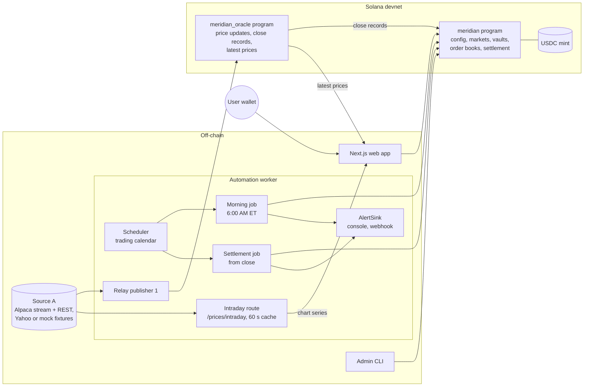

# Meridian Architecture

Meridian is a non-custodial app for trading same-day binary outcome contracts on the closing prices of seven large-cap US stocks (AAPL, MSFT, GOOGL, AMZN, NVDA, META, TSLA). Each contract asks "Will [TICKER] close at or above [STRIKE] today?" A Yes token pays $1.00 USDC if it does and a No token pays $1.00 USDC if it doesn't, so Yes + No always equals $1.00. Markets are created automatically each morning, trade on an on-chain order book during market hours, settle automatically from a price oracle after the close, and pay winners from a fully collateralized vault.

This document describes how Meridian is built. Requirement IDs (R1–R70) refer to the project's requirements list; §12 maps every one of them to the components below, and §13 explains how each gotcha is handled.

---

## 1. Summary of key choices

| Area | Choice |
| --- | --- |
| Chain | Solana. Devnet for all development and the demo. No mainnet, no real funds. Every script refuses mainnet. |
| On-chain programs | Rust + Anchor: `meridian` (markets, book, settlement) and `meridian_oracle` (relay price records) |
| Order book | Our own minimal CLOB inside the program, one book per strike (Yes vs USDC). Trader balances live in seats inside the book account, so a taker never has to pass maker accounts. |
| Price oracles | Two oracle slots with a plug-and-play adapter. The MVP and demo run our own **Meridian Price Relay** in slot 1 and leave slot 2 **disabled**. Pyth or Chainlink Data Streams can be switched into either slot by configuration (§5.6). Why a custom oracle: §5.1. |
| Market data | Alpaca market data (websocket stream for live prices, REST for bars) when its keys are set; otherwise a `mock` source that replays recorded fixtures for tests and offline use. The keyless Yahoo Finance chart API stays selectable. |
| Closing price | Official close → regular-session price stamped exactly at `close_ts` → linear interpolation between the nearest regular-session prices on each side of `close_ts`, each within 5 minutes |
| Settlement | One canonical close record per (signer, ticker, trading day), and one settlement price per ticker and day shared by every strike. Permissionless `settle_market`. Escalation: 30 s polling for 15 minutes, first alert and admin propose at +15 min, staggered polling, second alert at +50, admin-only finalize from +60 with the worker alerting the admin (D93). |
| Pair exit | **Merge** instruction: 1 Yes + 1 No → $1.00 USDC at any time before settlement |
| Strikes | Fixed ±3%, ±6%, ±9% plus the rounded previous close, rounded to $10 and deduplicated |
| Morning job | Starts 6:00 AM ET, all markets created by 8:00 AM ET |
| Frontend | TypeScript, React, Next.js, Solana wallet adapter. Live stock prices come from on-chain oracle accounts; the Markets charts read a cached intraday route on the worker. An Admin page is shown only to the admin wallet. |
| Automation | TypeScript / Node.js worker in the same repo. Finds markets on-chain; holds no state that a restart can lose. |
| Hosting | Railway for the web app and the automation worker |

---

## 2. System overview



### Components

| Component | Path | Responsibility |
| --- | --- | --- |
| `meridian` program | `programs/meridian` | Config, strike markets, Yes/No mints, USDC vaults with an internal collateral counter, order books, mint/merge/redeem, per-ticker-day settlement, admin fallback, pause |
| `meridian_oracle` program | `programs/meridian_oracle` | Relay signer registry, append-only `PriceUpdate` records, write-once `CloseRecord`s used for settlement, and one overwritten `LatestPrice` account per ticker for display |
| SDK | `packages/sdk` | TypeScript client generated from the Anchor IDLs, transaction builders for the four trade paths and the admin actions (propose, finalize, pause), PDA helpers, the No-view and cost-basis math, shared closing-price and strike math, and the mainnet guard |
| Price providers | `packages/price-providers` | Off-chain `PriceProvider`, `LivePriceProvider` and `IntradayPriceProvider` interfaces and the relay sources `alpaca`, `yahoo` and `mock` (plus demo replay), Pyth, Chainlink Data Streams, and a fake Alpaca websocket server for tests |
| Automation worker | `services/automation` | Scheduler, NYSE trading calendar (also imported by the web app), morning job, settlement job with escalation, relay publisher (close and live prices), alert sinks, health endpoint and the intraday price route |
| Web app | `app` | Landing, Markets, Trade, Portfolio and History pages, and an Admin page linked only for `Config.admin` (propose, finalize, pause and unpause; R70, D93) |
| Admin CLI | `services/automation/src/cli` | Initialize config, update config (including slot switches), add strike, propose and finalize admin price, pause and unpause |
| Scripts | `scripts` | Devnet deploy, config bootstrap, rent measurement, the full lifecycle demo, the `make e2e` stack and the private-port Anchor test runner. All chain scripts call the mainnet guard first. |
| Shared fixtures | `fixtures`, `packages/price-providers/fixtures` | Strike and closing-price cases read by both the Rust and TypeScript tests; recorded Yahoo and Alpaca responses and sample Pyth/Chainlink payloads for the provider tests |
| Integration tests | `tests` | Anchor tests (Mocha) on a local validator |

---

## 3. On-chain design (`meridian` program)

### 3.1 Units

- **USDC** has 6 decimals. $1.00 = `1_000_000` base units.
- **Yes and No tokens** have 6 decimals, so 1 token = `1_000_000` base units and pays at most $1.00. Orders are placed in whole tokens (lot size `1_000_000`).
- **Order prices** are in cents, from 1 to 99 (tick = $0.01). A Yes price of 65 means $0.65, and the implied No price is $0.35.
- **Strike and oracle prices** are signed integers with an exponent, as Pyth uses (`price × 10^expo`). Strikes are stored with the same exponent as the configured price sources, so comparisons never mix scales.

### 3.2 Accounts

| Account | Seeds | Key fields |
| --- | --- | --- |
| `Config` | `["config"]` | `admin`, `automation_authority`, `usdc_mint`, `tickers[7]`, `oracle_slots[2]` (see §5.3), `max_staleness_secs` (300), `max_conf_bps`, `admin_propose_delay_secs` (900), `admin_finalize_delay_secs` (3600), `paused`, `demo_mode` |
| `TickerDay` | `["day", ticker, trading_day]` | `ticker`, `trading_day`, `close_ts`, `status` (`Open`, `Final`), `settle_price`, `settle_expo`, `settle_source` (oracle slot or admin), `pending_admin_price`, `pending_admin_at`, and the exact final price as `settle_numerator / settle_denominator` (an interpolated close is a fraction; every strike compares against it, not the rounded `settle_price`). Created with the first strike of the day. Holds the one settlement price for every strike of that ticker and day. |
| `Market` | `["market", ticker, trading_day (YYYYMMDD), strike]` | `ticker`, `trading_day`, `strike`, `strike_expo`, `close_ts`, `mint_open_ts`, `trading_open_ts`, `ticker_day`, `yes_mint`, `no_mint`, `vault`, `book`, `collateral`, `pairs_outstanding`, `status` (`Open`, `Settled`), `outcome` (`Yes`, `No`), `settle_price`, `settle_source`, `demo`, `created_at` |
| Yes mint, No mint | `["yes", market]`, `["no", market]` | Mint authority is the `Market` PDA. No freeze authority. |
| Vault | `["vault", market]` | USDC token account owned by the `Market` PDA. Holds collateral only; order escrow lives elsewhere. |
| `OrderBook` | `["book", market]` | Zero-copy. Fixed-capacity bid and ask arrays, a fixed table of trader seats (`OpenOrders`), next order sequence number, and the base (Yes) and quote (USDC) escrow vaults |
| `OpenOrders` seat | inside `OrderBook` | `owner`, `free_yes`, `free_usdc`. Locked amounts are derived from the owner's resting orders. A seat is claimed by the owner's first `place_order` and released by `settle_funds` once it has no resting orders and no free balance. |

`close_ts`, `mint_open_ts` (9:00 AM ET) and `trading_open_ts` (9:30 AM ET) are Unix timestamps. The automation worker computes them from the exchange calendar and writes them at market creation, so DST and early-close days (1:00 PM ET) are handled without any calendar logic on-chain. Every settlement time rule below is relative to `close_ts`. All markets of one ticker and day must share the `TickerDay`'s `close_ts`; `create_strike_market` checks it.

**Why seats live inside the book.** A fill credits both the taker and the maker. If each trader had a separate `OpenOrders` account, the taker's transaction would have to list every maker it might hit, which costs 32 bytes per maker against the 1232-byte transaction limit (R27) and fails whenever the book moves between building and landing the transaction. Crediting makers inside the book removes both problems. The cost is a fixed seat count per book (§3.7).

### 3.3 Instructions

| Instruction | Who | Behavior |
| --- | --- | --- |
| `initialize_config` | Program upgrade authority, once | Sets admin, automation authority, USDC mint, tickers, oracle slots, thresholds and delays. Takes the program and its program-data account and requires the signer to equal the program-data `upgrade_authority_address`, so nobody can front-run it after deploy. A second call fails because the PDA exists. |
| `update_config` | Admin | Changes oracle slots, thresholds, delays or the automation authority. Has no access to `Market` or `TickerDay` accounts, so it can't change an existing market's strike, `close_ts` or outcome. |
| `set_demo_mode` | Admin | Turns `demo_mode` on or off. Only compiled in when the program is built with the `devnet` feature, which the devnet and local builds use (§6.5). |
| `create_strike_market` | Admin or automation authority | Creates one `Market`, its Yes/No mints, vault, `OrderBook` and escrow vaults, and the `TickerDay` if it doesn't exist yet. One strike per call, not batched. Fails if the PDA already exists (which makes the morning job idempotent), for an unknown ticker, or for any other signer. Custom `close_ts` and open times are accepted only in demo mode. |
| `add_strike` | Admin | Same as `create_strike_market`, allowed intraday before `close_ts`. There is no instruction that changes an existing strike. |
| `mint_pair(n)` | Anyone | Requires `mint_open_ts ≤ now < close_ts`, not paused, market open, `n > 0`. Transfers `n × 1_000_000` USDC into the vault, adds it to `collateral`, increments `pairs_outstanding`, and mints `n` Yes and `n` No to the caller. |
| `merge_pair(n)` | Anyone | Burns `n` Yes and `n` No from the caller and pays `n × 1_000_000` USDC from the vault, decrementing `collateral` and `pairs_outstanding`. Allowed before settlement, including while paused and after `close_ts`. Fails after settlement and when the caller holds fewer than `n` of either token. |
| `merge_pair_up_to(max_n, keep_yes)` | Anyone | Merges `m = min(yes_balance − keep_yes, no_balance, max_n)`, where `m` can be 0. Same rules as `merge_pair`. The client passes its Yes balance from before the transaction as `keep_yes`, so the program merges exactly the Yes this transaction added. Used by Sell No and by market Buy No (§3.4). |
| `place_order(side, kind, price, qty)` | Anyone | `side`: `Bid` (buy Yes) or `Ask` (sell Yes). `kind`: `Limit` (rests the remainder), `Market` (matches up to `price` as a worst-price limit, never rests, returns unfilled escrow), `PostOnly` (rejected if it would cross). Requires `trading_open_ts ≤ now < close_ts` and not paused. Claims a seat if the owner has none. Escrows `price × qty` USDC for bids and `qty` Yes for asks, matches by price-time priority at the maker's price, applies the self-trade rule (§3.7), credits both seats and emits one `OrderFilled` per fill. |
| `cancel_order(order_id)` | Order owner | Removes a resting order and returns its escrow to the owner's free balance. Allowed while paused, after `close_ts` and after settlement. |
| `settle_funds` | Seat owner | Withdraws free Yes and USDC from the book's escrow vaults to the owner's token accounts. Releases the seat when it is empty. Allowed at any time. |
| `settle_market` | Anyone, except for third-party oracle slots (§4.3) | Requires `now ≥ close_ts`. If the `TickerDay` is already `Final`, copies its price. Otherwise reads the slot's canonical close record (§4.1), applies the closing price rule, writes the price to the `TickerDay` (marking it `Final`), then writes the outcome to the market. Emits `MarketSettled`, and `AdminPriceMismatch` if a pending admin price differed. Fails on a settled market. Works while paused. |
| `propose_admin_price(ticker, trading_day, price)` | Admin | Allowed from `close_ts + admin_propose_delay_secs` (+900) while the `TickerDay` is not `Final`. Stores a pending price for the whole ticker and day. Replaces any earlier proposal. The admin enters a price, never an outcome. |
| `finalize_admin_settle(ticker, trading_day)` | Admin | Admin-only (D93): any other signer fails with `Unauthorized`. Allowed from `close_ts + admin_finalize_delay_secs` (+3600) when a price is pending and the `TickerDay` is not `Final`. Marks the `TickerDay` `Final` with source admin. Each strike then settles through `settle_market`, which copies the price. |
| `redeem(yes_amount, no_amount)` | Anyone | After settlement only. Burns the given tokens and pays `1_000_000` per winning token and 0 per losing token from the vault, decrementing `collateral`. Redeeming only losing tokens burns them and pays 0 without an error. Works while paused. Never expires. |
| `pause` / `unpause` | Admin | Halts `mint_pair` and `place_order` across all markets. Everything else keeps working. |

After settlement, users cancel any resting orders and call `settle_funds` to get their escrow back before redeeming. The web app bundles these steps into one transaction where it fits.

No account is ever closed: markets, vaults, mints and books stay so winners can redeem at any time.

### 3.4 The four trade paths

All four map onto one book per strike. The SDK builds each as **one transaction**, so the user signs once and the steps are atomic. For a wallet without Yes or No token accounts, the transaction starts with idempotent associated-token-account creation instructions. The seat is claimed by `place_order` itself, so no separate account creation is needed for it.

| User action | Instructions in the transaction |
| --- | --- |
| Buy Yes | `place_order(Bid, Market or Limit, price, qty)` → `settle_funds` |
| Sell Yes | `place_order(Ask, Market or Limit, price, qty)` → `settle_funds`. The seller picks Market (sell now at the best bid) or Limit (post a price and wait). |
| Buy No, market | `mint_pair(qty)` → `place_order(Ask, Market, 100 − no_price, qty)` → `settle_funds` → `merge_pair_up_to(qty, keep_yes)`. Unfilled pairs are merged back in the same transaction, so the user ends with No for the filled quantity and USDC for the rest, never a stray Yes+No pair. |
| Buy No, limit | `mint_pair(qty)` → `place_order(Ask, Limit, 100 − no_price, qty)` → `settle_funds`. The user holds both tokens until the Yes ask fills, and can cancel and merge from the UI. |
| Sell No | `place_order(Bid, Market, 100 − no_price, qty)` → `settle_funds` → `merge_pair_up_to(qty, keep_yes)`. The fill amount isn't known when the transaction is built, so the program computes the merge amount. |

The effective No price is exactly `$1.00 − Yes sale price` for Buy No and `$1.00 − Yes buy price` for Sell No, because fills execute at the maker's price.

**Transaction size.** The largest path is market Buy No from a fresh wallet. Because makers are credited in-book, its account list is fixed: the payer, three user token accounts, the config, the market, two mints, the vault, the book, two escrow vaults, and the token, associated token, system and `meridian` programs plus the event authority. That is about 17 keys (about 545 bytes) plus about 200 bytes of instruction data and a 64-byte signature, well under 1232 bytes. An integration test builds each path from a fresh wallet and asserts the serialized size and a single signature. If a later change pushes a path over the limit, the next step is a per-market address lookup table created by the morning job, and after that a composite instruction for that path.

### 3.5 Position constraint

A user must not hold Yes and No for the same strike as a resting position created from the trading UI. This is enforced in the web app and the SDK transaction builders: they read the wallet's Yes and No balances and refuse Buy Yes while No is held, or Buy No while Yes is held, prompting the user to exit with Sell No or Sell Yes first. The SDK builders throw the same error the UI shows.

Exception: a wallet holding both tokens because of a resting Buy No limit order can always cancel and close out (cancel, `settle_funds`, `merge_pair`) from the UI.

It is not enforced on-chain. Both Buy No (limit) and Sell No legitimately pass through holding both tokens, and SPL tokens can be transferred between wallets, so an on-chain check would block valid flows without preventing the state.

### 3.6 Collateral and invariants

The program tracks collateral in `Market.collateral` and never trusts the vault's token balance for accounting. Two things can make the real balances differ from the counters:

- **Donations.** Anyone can transfer USDC straight into a vault. The checks use `vault.amount ≥ collateral`, never equality, so a donation can't brick the market. Payouts come from `collateral`, so donated USDC is never paid out. It stays in the vault; there is no sweep instruction, because R8 allows USDC to leave a vault only to mint, merge and redeem callers.
- **Direct burns.** A holder can burn their own Yes or No with the token program, outside Meridian. Supply can then only be lower than `pairs_outstanding × 1_000_000`, so every supply check uses `≤`. The collateral behind burned tokens stays in the vault.

The README documents both cases. Order-book escrow lives in the book's own escrow vaults, never in the collateral vault.

The program checks these after every state-changing instruction, and the test suite asserts them.

| ID | Invariant |
| --- | --- |
| INV-1 | Before settlement: `collateral == pairs_outstanding × 1_000_000`, `vault.amount ≥ collateral`, and Yes supply and No supply are each `≤ pairs_outstanding × 1_000_000` |
| INV-2 | After settlement: `collateral ≥ winning-side supply × 1_000_000`, `vault.amount ≥ collateral`, and each redeem pays exactly `1_000_000` per winning token |
| INV-3 | Yes payout + No payout = $1.00 for every possible settlement price |
| INV-4 | Yes and No are minted only by `mint_pair`, and burned by Meridian only through `merge_pair`, `merge_pair_up_to` and `redeem`. Mint authority is the market PDA. Order book escrow, matching, cancel and `settle_funds` move tokens but never change supply. |
| INV-5 | Once `status == Settled`, `outcome`, `settle_price` and `settle_source` never change. Once a `TickerDay` is `Final`, its price never changes. |
| INV-6 | There are no fees. No instruction charges one. |

### 3.7 Order book rules and limits

- **Capacity:** 32 resting orders per side and 32 seats per book. A new resting order on a full side, or a new trader when all seats are taken, fails with a clear error and leaves the book unchanged.
- **Fill cap:** at most 16 matches per `place_order`. A market order that would exceed the cap fills up to it and returns the rest. An integration test sweeps the cap in one taker order and asserts it stays under 1.4M compute units.
- **Priority:** order IDs combine price and a sequence number, so sorting gives price-time priority. Fills execute at the resting (maker) order's price; a bid at 70 against an ask at 60 fills at 60, and the taker's unused 10¢ per token returns to its free balance.
- **Self-trade:** when an incoming order would match a resting order from the same seat, the resting order is cancelled, its escrow returns to the owner's free balance, and matching continues. Each self-trade cancel counts against the fill cap, so compute stays bounded.
- **Events:** every fill emits `OrderFilled { market, maker, taker, maker_order_id, taker_side, price, qty, ts }`. Makers' fills happen inside someone else's transaction, so naming both sides is what lets a maker's history show them (§7). Events use Anchor's `emit_cpi!` so long transactions can't truncate them.

### 3.8 Rent

Each market creates two mints (82 bytes each), three token accounts (the vault and two escrow vaults, 165 bytes each), the `Market` account (about 300 bytes) and the `OrderBook` (about 3.3 KB at the capacities above). At devnet's rent-exempt rate of about 0.00696 SOL per KB (including the 128-byte account overhead), that is about **0.04 SOL per market**, or about **2 SOL per trading day** for about 49 markets, plus a small `TickerDay` per ticker. Because accounts are never closed, this accumulates. Book capacity was chosen with this cost in mind: 128 orders per side would roughly triple it. `scripts/measure-rent.ts` measures the real cost on the local validator and the README records the result. The demo creates only the markets it needs.

---

## 4. Settlement

### 4.1 Canonical inputs

`settle_market` is permissionless, so the outcome must not depend on which accounts the caller passes. For a relay slot, it doesn't take a list of price accounts at all. It takes exactly one `CloseRecord` at the PDA `["close", slot_signer, ticker, trading_day]` in `meridian_oracle`, where `slot_signer` comes from `Config`. Anchor's seed and owner constraints reject any other account: an account not owned by `meridian_oracle`, a record from an unregistered signer or a signer outside the slot, an intraday `PriceUpdate`, a `LatestPrice`, or a record for another ticker or day. The record also stores the `close_ts` it was built for, which must equal the market's.

The relay writes a `CloseRecord` once per ticker and day (§5.4), and it can't be overwritten, so there is only one valid input for each slot, ticker and day.

On top of that, the first successful settlement of any strike writes the price to the ticker's `TickerDay` and marks it `Final`. Every other strike of that ticker and day copies that price, whoever calls and whatever they pass. So every strike settles at one price, outcomes are monotone in strike (Yes wins for every strike ≤ the price and loses for every strike above it), and an attempt to settle one strike at a different price fails.

Slot 2 can settle a `TickerDay` only when slot 1 has no `CloseRecord` for it: the caller must pass slot 1's record address and the program checks that it is uninitialized. This stops a caller choosing whichever slot they prefer when both have answered. While slot 2 is disabled (the MVP), this rule is inactive.

### 4.2 Closing price rule

The program reads the record's updates and accepts exactly one of these shapes, checked in this order:

1. **Official close.** One update flagged `official_close` for this ticker and day, with `close_ts ≤ publish_time ≤ close_ts + max_staleness_secs`.
2. **Exact timestamp.** One regular-session update with `publish_time == close_ts`.
3. **Linear interpolation.** Two regular-session updates `(P₁, t₁)` and `(P₂, t₂)` with `close_ts − 300 ≤ t₁ < close_ts < t₂ ≤ close_ts + 300`.

For each update used, the program checks that it belongs to the market's ticker, that the price is positive, that it is regular-session (which keeps after-hours prices out), and that `conf / price ≤ max_conf_bps`.

**Staleness is measured against `close_ts`, not against the clock when the settle transaction lands.** Every update used must satisfy `|publish_time − close_ts| ≤ max_staleness_secs` (default 300). The clock is only used for `now ≥ close_ts` and the admin delays. So a 3:59:30 update that forms a valid pair is accepted when settlement lands at 4:12, a 3:50 update is stale, and a lone 4:01 update matches no shape.

Comparison against the strike uses exact integer math with no division, so a price that lands on the strike can never round the wrong way:

- Shapes 1 and 2: Yes wins if `P ≥ strike`.
- Shape 3: Yes wins if `P₁ × (t₂ − t₁) + (P₂ − P₁) × (close_ts − t₁) ≥ strike × (t₂ − t₁)`. Use `i128`.

Exactly at the strike pays Yes. The stored `settle_price` for shape 3 is the interpolated value, rounded to the price exponent, for display only. Because every strike of a ticker settles from the same record, each one's exact comparison agrees with every other.

The same function lives in `packages/sdk` for the web app and the worker, and both implementations run one shared JSON fixture file.

### 4.3 Third-party oracle slots

When a slot is `Pyth` or `ChainlinkDataStreams`, the inputs are signed updates that anyone can fetch for many timestamps, and the program can't prove which pair is the canonical one. So for those slots `settle_market` also requires the automation authority or the admin as signer. Once one strike has settled, the `TickerDay` price makes every other strike permissionless again, because it only copies. Neither kind is used live in the MVP.

### 4.4 Escalation schedule

Times are relative to `close_ts`. On a normal day `close_ts` is 4:00 PM ET. The schedule runs per ticker and day, because one price settles every strike of that ticker.

| Time | Worker action | On-chain rule |
| --- | --- | --- |
| +0:00 | Poll oracle slot 1 every 30 s. Call `settle_market` as soon as a valid close record exists. | `settle_market` allowed from `close_ts` |
| +0:04 | No valid price yet: also poll slot 2 every 30 s. Skipped while slot 2 is disabled. | — |
| +0:00 to +0:15 | Keep polling every 30 s: about 30 attempts on slot 1. No alert. | — |
| +0:15 | No valid price yet: **first admin alert**, exactly once. Switch to staggered polling: each slot once every 3 min, offset by 1 min (slot 1 at +0:16, +0:19, …; slot 2 at +0:17, +0:20, …). With slot 2 disabled, slot 1 is polled every 3 min. | `propose_admin_price` allowed (`admin_propose_delay_secs = 900`) |
| +0:50 | No valid price yet: **second admin alert** | — |
| +1:00 | If an admin price is pending, **alert the admin to finalize it**. The worker holds no admin key and never finalizes (D93). Once the admin's `finalize_admin_settle` lands, the worker calls `settle_market` for each strike. Otherwise keep staggered polling until an oracle answers or the admin proposes. | `finalize_admin_settle` allowed for the admin only (`admin_finalize_delay_secs = 3600`) |

The first valid answer from either slot settles the ticker and stops all polling for it. Tickers settle independently, so one ticker's oracle trouble delays no other. An oracle answer before finalization always beats a pending admin price; when the values differ, the program emits `AdminPriceMismatch` and the worker logs both values and alerts the admin.

The admin may only propose the exchange's official published closing price. The pending and final values are both on-chain and public.

**Latency target.** The stricter of the two source targets applies: with the relay answering, every open market of the day settles by `close_ts + 5 min`. The relay waits up to 3 minutes for the official close before falling back to interpolation (§5.4), and the worker polls every 30 s, which leaves about 90 s for the settle transactions. A test with the fake chain and recorded fixtures checks it, and the devnet demo logs each market's settlement delay.

---

## 5. Price sources (plug and play)

### 5.1 Why a custom oracle for development and the demo

The spec asks for settlement from a price oracle on the chain. These were the options for US equity closing prices on Solana when this was designed:

| Option | Status for this project |
| --- | --- |
| Pyth (US equity feeds) | Feeds exist for all 7 tickers, but US equity access costs about $500/month. The current access key is valid but isn't entitled to equities (`Not entitled … asset type 'equity'`). |
| Chainlink Data Streams (US equity streams) | The account has no streams assigned and no testnet credentials, so there is nothing to verify against on devnet. |
| Switchboard | Shut down in September 2026. |
| RedStone, Stork | No suitable US equity feeds on Solana. |

None of them can be used on devnet without cost or credentials the project doesn't have. So development and the demo use our own oracle, the **Meridian Price Relay**: a small on-chain program (`meridian_oracle`) plus a publisher in the automation worker that signs prices from a market-data source. It costs nothing, works on devnet and the local validator, and exercises the same settlement path a third-party oracle would.

**The trust trade-off.** The relay is a centralized oracle. Users must trust the operator not to publish a false price, and in the MVP there is one data source and one signer key. A false close record would settle the market, and settled outcomes are final. Nothing on-chain prevents that in the MVP; the design makes it visible and limits the room for error:

| Mitigation | How |
| --- | --- |
| Public records | Every value the relay publishes is an on-chain `PriceUpdate` with its source timestamp, and every settlement points at a `CloseRecord`. Anyone can compare them with the public closing price. |
| No rewriting | `PriceUpdate`s are append-only and `CloseRecord`s are write-once. A `publish_time` more than 60 s in the future is rejected. |
| No caller choice | One canonical record per signer, ticker and day, and one price per ticker and day (§4.1). |
| Narrow rule | Only regular-session prices within 5 minutes of `close_ts`, with a confidence check, are accepted (§4.2). |
| Separate keys | The relay signer is its own keypair, separate from the admin and automation keys, and the signer registry is admin-controlled. |
| Alerts and fallback | The worker alerts when no valid price arrives, the admin fallback is delayed by 15 and 60 minutes, and an oracle answer that differs from a pending admin price raises `AdminPriceMismatch`. |
| Exit path | Slot 2 is ready for a second, independent source, and either slot can be switched to Pyth or Chainlink by configuration (§5.6). |

The README states this trade-off plainly. It makes no regulatory or compliance claims.

### 5.2 Third-party options are designed in

The Pyth and Chainlink Data Streams adapters are implemented and unit-tested against recorded sample payloads (§5.7, §5.8), but not used live. Switching to one of them needs a paid or provisioned account, not a code change.

### 5.3 The abstraction

Each of the two **oracle slots** in `Config` holds:

- `kind`: `Disabled`, `MeridianRelay`, `Pyth` or `ChainlinkDataStreams`
- `kind: Disabled` means the slot is skipped entirely
- for `MeridianRelay`: the relay signer public key for that slot
- for `Pyth`: the 7 feed IDs, and the minimum verification level
- for `ChainlinkDataStreams`: the 7 stream IDs and the verifier program ID

**On-chain**, `settle_market` takes a slot index and that slot's inputs as remaining accounts: one `CloseRecord` for a relay slot, or the signed updates for Pyth or Chainlink. A `price_adapter` module turns any kind into one `NormalizedPrice`:

```rust
pub struct NormalizedPrice {
    pub price: i64,          // price × 10^expo
    pub conf: u64,           // same scale as price
    pub expo: i32,
    pub publish_time: i64,   // unix seconds, from the source, not the publish transaction
    pub session: Session,    // Regular | OutsideRegular
    pub official_close: bool,
}
```

The closing price rule (§4.2) only ever sees `NormalizedPrice` and imports no concrete provider, so it is identical whichever oracle is configured.

**Off-chain**, `packages/price-providers` defines three small interfaces:

```ts
interface PriceProvider {
  name: string
  // The updates for this ticker's close, or null if no valid shape exists yet.
  prepareClose(ticker: string, closeTs: number): Promise<SettlementInputs | null>
  // Previous close for strikes. Rejects with `stale` when the newest close is older than the day.
  previousClose(ticker: string, previousTradingDay: string): Promise<PreviousClose>
}

interface LivePriceProvider {
  name: string
  latest(ticker: string): Promise<NormalizedPrice | null>   // display only
}

interface IntradayPriceProvider {
  name: string
  // Regular-session 1-minute closes in [fromTs, toTs], oldest first (Markets chart only).
  intraday(ticker: string, fromTs: number, toTs: number): Promise<IntradayPoint[]>
}
```

A relay source implements all three (`RelaySource = PriceProvider & LivePriceProvider & IntradayPriceProvider`, plus an optional `close()` that shuts a websocket). It is the only part that talks to a market-data API. `createRelaySource(env, slot)` builds the one named by `RELAY_<slot>_SOURCE` (§5.5).

### 5.4 Meridian Price Relay (MVP and demo)

Our own oracle. Each relay publisher has its own signer key and its own market-data source, so if a second relay is added later the two slots stay independent.

**`meridian_oracle` program:**

| Account or instruction | Behavior |
| --- | --- |
| `SignerRegistry` (`["signers"]`) | Registered relay signers. Admin-controlled. |
| `publish_price` → `PriceUpdate` (`["price", signer, ticker, publish_time]`) | Only a registered signer can publish. Stores `price`, `conf`, `expo`, `publish_time`, `session`, `official_close`. Append-only: a second write to the same `(signer, ticker, publish_time)` fails. A `publish_time` more than 60 s in the future is rejected. |
| `publish_close` → `CloseRecord` (`["close", signer, ticker, trading_day]`) | Takes the one or two `PriceUpdate`s from the same signer and ticker that form the settlement shape, copies their values with the shape and `close_ts`, and is write-once. This is the only account `settle_market` reads for a relay slot. |
| `publish_latest` → `LatestPrice` (`["latest", signer, ticker]`) | Overwritten in place, so rent stays flat. Display only; settlement never reads it. |

**Relay publisher** (in the worker), after `close_ts`, for each ticker:

1. Poll the source for the **official close** every 30 s. When it has one, publish it with `official_close = true` and `publish_time` = the source's timestamp, then publish the `CloseRecord`.
2. If there is no official close by `close_ts + 180 s`, publish the **interpolation pair** from the 1-minute bars if both sides exist, then the `CloseRecord`. If neither shape is available, keep polling; the settlement job escalates on its own schedule.

Waiting 3 minutes for the official close before falling back keeps shape 1 the normal case while still meeting the 5-minute settlement target. Because the record is write-once, the relay never publishes a worse shape and then a better one.

**Confidence:** half the bid-ask spread when the source provides bid and ask; otherwise half the high-low range of the 1-minute bar the price came from.

**Live prices:** during regular hours the publisher calls `publish_latest` for all 7 tickers at least every 60 s, all in one transaction. That is about 390 transactions per trading day.

Every published value is logged with its source, timestamp and transaction signature.

### 5.5 Data sources

**Selection.** `RELAY_1_SOURCE` picks the source: `alpaca`, `yahoo` or `mock`. Left empty, it is `alpaca` when `ALPACA_API_KEY` and `ALPACA_API_SECRET` are both non-blank, otherwise `mock`. So a fresh checkout without keys runs offline on `mock`, and adding the keys switches to live data with no other change. Naming `alpaca` without the keys is a startup error that names the missing variables. With `DEMO_MODE=true`, `mock` becomes the demo replay source (§6.5).

**Default source: Alpaca market data (`RELAY_1_SOURCE=alpaca`, R67).** REST (`/v2/stocks/…`, key pair in headers) serves daily and 1-minute bars and batched snapshots; the websocket streams trades and quotes for the 7 tickers. The source only calls `/v2/stocks/…` routes, never orders, account or positions.

| Variable | Meaning |
| --- | --- |
| `ALPACA_API_KEY`, `ALPACA_API_SECRET` | Required for `alpaca`. Read from env only; never committed or logged. |
| `ALPACA_DATA_URL` | REST base. Empty means `https://data.alpaca.markets`. |
| `ALPACA_STREAM_URL` | Websocket. Empty means `wss://stream.data.alpaca.markets/v2/iex` (the free plan's stream). Must be `ws(s)`. |
| `ALPACA_API_ENDPOINT` | The trading API. Never used for data, except that a value whose host starts with `data.` is taken as the REST base. |

Blank values count as unset, and an invalid URL is a startup error naming the variable.

**Feeds.** The free plan's real-time data comes from one exchange (IEX). SIP (consolidated) data is served only once it is older than about 15 minutes; newer SIP requests get HTTP 403. So a REST request whose window ends more than 16 minutes ago asks SIP, anything newer asks IEX, and a SIP 403 still falls back to IEX. Two values never fall back: the official close and the previous close use SIP only, so neither ever comes from one exchange's volume.

**Stream.** Opened lazily on the first `latest` call. Trades outside 09:30–16:00 ET (by their own timestamp) are dropped, so after hours `latest` keeps the day's last regular-session trade. Reconnects back off from 1 s doubling to 60 s and reset after a successful subscribe; an auth failure takes the same path. While the stream is down, one batched IEX snapshot request serves all 7 tickers, shared by concurrent calls for 5 s. The worker closes the stream when it stops.

| Need | How |
| --- | --- |
| Need | How |
| --- | --- |
| Official close (shape 1) | The SIP daily bar of the close day (equal to the closing-auction print), stamped in `[close_ts, close_ts + 300)`, conf 0. While SIP is refused (the first ~16 minutes after close) there is none. |
| Interpolation fallback (shape 3) | A pair from 1-minute bars (SIP, IEX while SIP is refused): the last bar before close at `close_ts − 1` and the 16:00 bar's open at `close_ts + 1`, conf half the bar range. Never marked official; no bar after the closing minute is used. |
| Previous close for strikes | The SIP daily bar dated the expected previous trading day, asked with `end = now − 16 min`. Older, or SIP refused, means `stale`. |
| Live display price | The stream's latest regular-session trade, conf half the quoted spread; the IEX snapshot while the stream reconnects. |
| Intraday chart (R66) | 1-minute bars by the feed rule above, regular session only. During the session the whole series is IEX, so it has no feed seam. |

HTTP 429 fails fast while backing off (capped at 10 minutes), any other 401 or 403 is `unauthorized`, and a call makes at most 3 requests; network errors become `http`. Tests run against small captured fixtures in `packages/price-providers/fixtures/alpaca/` (with provenance) and a local RFC 6455 fake websocket server (`@meridian/price-providers/testing`); no test touches the network.

**Interaction with the relay's 3-minute wait.** The relay waits until `close_ts + 180 s` for an official close (§5.4), but on the free plan SIP refuses the close bar until about +16 min. So with Alpaca the close normally settles at shape 3 from the IEX bars around 4:00 PM, inside the 5-minute target, rather than at shape 1. If IEX has no 16:00 bar, the relay keeps polling and publishes the SIP official close once it is served.

**Optional source: Yahoo Finance chart API (`RELAY_1_SOURCE=yahoo`).** Free and keyless, and used only when selected explicitly; it was the default before Alpaca and was too often rate-limited. The relay uses the chart endpoint (`/v8/finance/chart/<TICKER>`) with regular-session data only:

| Need | How |
| --- | --- |
| Official close (shape 1) | `meta.regularMarketPrice` when `meta.regularMarketTime ≥ close_ts` and the regular session has ended (`meta.currentTradingPeriod.regular.end ≤ now`). This is the closing-auction price. After-hours and pre-market fields are never read. |
| Interpolation fallback (shape 3) | 1-minute bars with pre/post-market excluded. The close of the last bar before `close_ts` is published with `publish_time = close_ts − 1`, and the first regular-session price at or after `close_ts` with `publish_time = close_ts + 1`. If Yahoo returns no regular-session data at or after the close, there is no shape 3, and the admin path applies. |
| Previous close for strikes | Daily bars. The relay takes the close (not the adjusted close) of the bar dated the expected previous trading day. If the newest bar is older than that, the morning job treats it as stale (§6.1). |
| Live display price | `meta.regularMarketPrice` and `regularMarketTime` during regular hours |
| Intraday chart (R66) | `interval=1m` with `period1`/`period2` over the session window, regular session only |

Timeouts, HTTP 429 and malformed responses are handled with backoff and tested against recorded responses in `packages/price-providers/fixtures/yahoo/`.

**Caveats.** The API is unofficial and undocumented: it can change shape or disappear without notice. Its terms don't clearly permit republishing prices, which is acceptable for a devnet project with no real funds but not beyond that. It may rate-limit or block cloud IP ranges such as Railway's. The relay keeps its request rate low (7 tickers per minute during the day, a few requests per ticker around the close), backs off on 429, and the README documents all three caveats. The `RelaySource` interface keeps it swappable.

**`mock` source (`RELAY_1_SOURCE=mock`, or no Alpaca keys).** Replays recorded fixtures with no network, for all 7 tickers (some fixtures are hand-written in the recorded schema and marked so). Its intraday chart is a deterministic synthetic minute series around the recording's last price, not real data. Used by every automated test, by `make dev` and for offline work. In demo mode it replays a recorded real close from a past trading day, re-stamped to the demo `close_ts` and labeled as replayed in its logs (§6.5).

**Second source (not in the MVP).** Slot 2 ships as `Disabled`. Adding a second source later means writing one `RelaySource` implementation, giving it its own signer key, and switching slot 2 to `MeridianRelay` (or to `Pyth` / `ChainlinkDataStreams`). Criteria for a second stock-data source: consolidated US prices, not a single venue; at most about 1 minute of delay; ideally an official daily close field; terms that allow publishing a derived settlement value.

### 5.6 Switching a slot to Pyth or Chainlink

Switching is configuration only: `update_config` on-chain plus env vars for the worker. No settlement code changes. Do it outside market hours, so no ticker-day is half-settled under the old slot.

| Step | Pyth | Chainlink Data Streams |
| --- | --- | --- |
| 1. Account | A Pyth plan entitled to US equities | US equity streams assigned to the account, testnet credentials and the devnet verifier program ID |
| 2. Worker env | `ORACLE_SLOT_1=pyth`, `PYTH_RECEIVER_PROGRAM_ID`, `PYTH_FEED_IDS`, `PYTH_ACCESS_TOKEN` | `ORACLE_SLOT_1=chainlink`, `CHAINLINK_VERIFIER_PROGRAM_ID`, `CHAINLINK_STREAM_IDS`, `CHAINLINK_DATA_STREAMS_USERNAME`, `CHAINLINK_HMAC_SECRET` |
| 3. On-chain | `update_config` (admin): slot kind `pyth`, the 7 feed IDs, `verifier_program` = the receiver program, `min_verification_level` 0 (full) | `update_config` (admin): slot kind `chainlinkDataStreams`, the 7 stream IDs, `verifier_program` = the verifier program |
| 4. Restart | Restart the `automation` service | Restart the `automation` service |
| 5. Check | `make demo` on devnet settles from the new slot | Same |

To keep the relay running alongside, use slot 2 instead of slot 1 (`ORACLE_SLOT_2`, `--slot 2`). Rolling back is the same steps with `relay` / `--kind relay --signer <pubkey>`. Settlement from a third-party slot is restricted to the automation authority or admin (§4.3).

### 5.7 Pyth adapter

- **Feeds:** `Equity.US.<TICKER>/USD`. The schedule is regular hours only (09:30–16:00 ET, with holidays and half days). Feed IDs:

  | Ticker | Feed ID |
  | --- | --- |
  | AAPL | `49f6b65cb1de6b10eaf75e7c03ca029c306d0357e91b5311b175084a5ad55688` |
  | MSFT | `d0ca23c1cc005e004ccf1db5bf76aeb6a49218f43dac3d4b275e92de12ded4d1` |
  | GOOGL | `5a48c03e9b9cb337801073ed9d166817473697efff0d138874e0f6a33d6d5aa6` |
  | AMZN | `b5d0e0fa58a1f8b81498ae670ce93c872d14434b72c364885d4fa1b257cbb07a` |
  | NVDA | `b1073854ed24cbc755dc527418f52b7d271f6cc967bbf8d8129112b18860a593` |
  | META | `78a3e3b8e676a8f73c439f5d749737034b139bbbe899ba5775216fba596607fe` |
  | TSLA | `16dad506d7db8da01c87581c87ca897a012a153557d4d578c3b9c9e1bc0632f1` |
- **Off-chain:** the worker calls Hermes `GET /v2/updates/price/{publish_time}?ids[]=…` with `Authorization: Bearer $PYTH_ACCESS_TOKEN` at `close_ts`, and posts the signed updates through the Pyth Solana receiver program (same address on devnet and mainnet). Pyth does not keep equity accounts fresh on Solana itself, so we post our own.
- **On-chain:** the adapter reads the receiver's price update accounts, requires full verification, and maps `price`, `conf`, `exponent` and `publish_time` to `NormalizedPrice`. Session comes from the publish time falling inside regular hours. Pyth does not label an official close, so it settles through shapes 2 and 3.

### 5.8 Chainlink Data Streams adapter

- **Streams:** US equity streams in the **RWA Advanced (v11)** report schema, which Chainlink recommends for US equities. It includes `mid`, `bid`, `ask`, `lastTradedPrice`, `marketStatus` and `lastSeenTimestampNs`.
- **Off-chain:** the worker calls `GET /api/v1/reports?feedID=…&timestamp=…` (HMAC-signed headers using `CHAINLINK_DATA_STREAMS_USERNAME` and `CHAINLINK_HMAC_SECRET`; set a `User-Agent` header, which the API requires) at `close_ts`, and passes the `fullReport` to `settle_market_with_reports`.
- **On-chain:** the adapter verifies each report by CPI to the Chainlink verifier program and decodes it. `price = lastTradedPrice` if present, else `mid`; `conf = (ask − bid) / 2`; `session = Regular` only when `marketStatus` is regular hours. No official close label.

---

## 6. Automation worker

One long-running Node.js process. The worker keeps no state that matters across restarts: everything it needs is read from the chain.

### Trading calendar

All times are America/New_York, from the calendar in `services/automation/src/calendar`. It knows weekends, NYSE holidays and early closes (1:00 PM ET) for 2026 and 2027; the data is checked in and covered by tests. Besides the trading-day times the jobs use, it has two pure functions for display:

- `chartSession(now)`: the session the Markets chart shows. Inside the regular session it is today, live, from 9:30 AM to now. Otherwise it is the most recent complete session: today's after the close, the previous trading day's before the open or on a non-trading day. The open counts as live, the close as closed.
- `nextOpen(now)` and `reopenLabel(now)`: while the session is closed, 9:30 AM ET of the next open and the text "Reopens today|tomorrow|<Mon…Fri> 9:30 AM ET". Weekends and holidays are skipped; early closes don't move the next open. On a Saturday or Sunday the label always names the day ("Reopens Mon"); "tomorrow" is used only on weekdays. Both return null while the session is open.

**Shared with the app.** The web app imports the calendar directly instead of asking the worker over HTTP, so the Closed state needs no extra data. `@meridian/automation` exports `./calendar` and `./calendar/next-open` as package subpaths, Next.js transpiles the package (`transpilePackages`), and those files import nothing but the calendar data, never Node built-ins. The tests for these functions force `TZ=Asia/Tokyo`, which is a calendar day ahead of ET every evening, so a function that used the host's time zone fails.

### 6.1 Morning job (trading days, 6:00 AM ET, must finish by 8:00 AM ET)

1. For each ticker, get the previous close from slot 1's provider, falling back to slot 2 when it is enabled. If the returned close is dated before the expected previous trading day (from the calendar: Friday for a Monday, the last trading day after a holiday), skip that ticker and alert.
2. Compute strikes in integer cents: `round_to_10(prev × (1 ± p))` for p ∈ {3%, 6%, 9%}, plus `round_to_10(prev)`, halves rounding up, then deduplicate and sort. The same function and fixture file are used on both sides of the stack.
3. Call `create_strike_market` once per strike, one transaction each, sequentially. "Already exists" counts as success (idempotent).
4. Log each result. Retry failures with exponential backoff. If any ticker is still incomplete at 7:30 AM ET, alert.

### 6.2 Settlement job

- **Discovery on-chain.** The job lists open `Market` accounts with `getProgramAccounts` (filtered by account type and `status = Open`) and groups them by ticker and day. It rescans every minute from `close_ts` and every 5 minutes otherwise, so a market added at 2 PM with `add_strike` is picked up, a restart during the day loses nothing, and unsettled markets from earlier days are found.
- **Phase from the clock.** The escalation phase for each ticker-day comes from `now − close_ts`, not from in-memory counters. After a restart past +15 min the job goes straight to staggered polling, and past +60 min it sends the finalize alert for a pending admin price. A restart can repeat an alert that was already sent; it can't skip one.
- **Per ticker-day.** It runs the schedule in §4.4 once per ticker and day, settles the `TickerDay` through the first strike, then calls `settle_market` for the remaining strikes (several per transaction).
- "Already settled" is treated as success, with no alert.

### 6.3 Relay publisher

Described in §5.4. It runs the close sequence after each `close_ts` and the live-price loop during regular hours.

### 6.4 Alerts

```ts
interface AlertSink {
  name: string
  send(alert: Alert): Promise<void>
}
```

Two sinks ship: `console` (structured JSON logs) and `webhook` (JSON POST to `ALERT_WEBHOOK_URL`). `ALERT_SINKS` selects them (default `console`). Email, SMS or a chat tool can be added by implementing the interface. Each send is wrapped so a failing sink is logged and never crashes the worker. Alerts fire for morning job failures and stale previous closes, the +15 and +50 minute settlement alerts, the +60 alert asking the admin to finalize a pending price (D93), `AdminPriceMismatch`, and invariant failures. Unit tests use a fake sink.

### 6.5 Demo mode

The lifecycle demo can't wait for a real 4:00 PM close. When `Config.demo_mode` is on, the admin can create a market with a custom `close_ts`, `mint_open_ts` and `trading_open_ts` a few minutes ahead. `set_demo_mode` exists only in builds with the program's `devnet` feature, and the scripts refuse to enable it unless the cluster is localnet or devnet. The demo relay uses the `mock` source to publish a **recorded real close from a past trading day**, re-stamped to the demo `close_ts` and labeled as replayed in its logs. Demo markets carry `demo = true`, and the UI shows a "Demo market" badge on them.

### 6.6 Mainnet guard

`assertNotMainnet` in `packages/sdk` throws when the cluster name or RPC URL points at mainnet-beta. Every deploy, bootstrap and demo script, and the worker at startup, calls it first. Scripts that send transactions also compare the RPC's genesis hash with mainnet-beta's and refuse on a match, which catches a custom RPC URL that doesn't say "mainnet".

### 6.7 Health and the intraday price route

The worker runs one small HTTP server on `PORT` (8080 locally; Railway sets it):

- `GET /healthz` for the Railway health check. It reports the last successful scan and relay publish.
- `GET /prices/intraday/<ticker>`, the Markets chart's data (R66). It is read-only, display-only and allows any origin (CORS `*`). The body is `{ ticker, live, sessionDate, openTs, endTs, earlyClose, points: [{ t, price }] }` for the window `chartSession(now)` picks, with points trimmed to it. An unlisted ticker answers 404 `unknown-ticker`; an upstream 429 answers 503 `rate-limited`; any other failure 503 `unavailable`.

**Caching.** Each ticker's result, success or failure, is cached for 60 s (`INTRADAY_CACHE_SECS`), and the pending request itself is cached, so concurrent page loads share one upstream call. That bounds upstream traffic to one request per ticker per minute however many browsers are open, and a failing provider is never retried inside the window. The route has its own relay source instance, so a 429 backoff caused by chart traffic never delays the relay publisher. Settlement never reads it.

---

## 7. Web app

Next.js (App Router), TypeScript, Solana wallet adapter (Phantom and Solflare at least), and the Anchor client from `packages/sdk`.

| Page | Contents |
| --- | --- |
| Landing | What Meridian is, live prices, connect-wallet button |
| Markets | Grid of the 7 tickers. Each card shows the live price (or the last close while closed), the number of active contracts, an intraday chart and the market state (below). |
| Trade | Strike list of contract cards (strike, Yes and No prices, implied probability); the order book in a Yes view and a No view; the Buy Yes / Sell Yes / Buy No / Sell No panel with Market or Limit; a countdown to `close_ts` shown in ET whatever the browser's time zone, honoring early closes; and the payoff line "You pay $X. You win $1.00 if [TICKER] closes above [STRIKE]." with a visible note that a close exactly at the strike pays Yes ("… closes below [STRIKE]." for No). Settled cards show the settlement price, its source (oracle or admin), the winning side, and $1.00 / $0.00 per token. |
| Portfolio | Positions with entry price, current price and P&L; settled outcomes with price and source; Redeem; one "close out orders and redeem" action (cancel, `settle_funds`, redeem in one transaction where it fits); a market-maker view with net Yes and No per strike, fills and P&L |
| History | The user's fills (as maker or taker), mints, merges and redemptions, decoded from program events |
| Admin | Linked only when the wallet is `Config.admin`; anyone else sees "Admin only". Per ticker and day: propose a price (from `close_ts + 900`) and finalize a pending one (from `+3600`), each button enabled only when the program allows it and showing its opening time in ET, early closes included; pause and unpause. One signature per action (R70, D93) |

- **Two views of one book.** The No view is computed from the Yes book: No asks = `100 − Yes bids`, No bids = `100 − Yes asks`, same quantities, each sorted best-first. Executable quotes: Buy Yes = best Yes ask; Sell Yes = best Yes bid; Buy No = `100 − best Yes bid`; Sell No = `100 − best Yes ask`. The implied No price beside a Yes price is `100 −` that price. The mapping lives in `packages/sdk` and one fixture checks both views.
- **Real-time book.** Websocket `accountSubscribe` on the open market's `OrderBook` and `Market` accounts, with polling as a fallback. Another wallet's new order shows within 2 seconds.
- **Live prices from the oracle.** The app subscribes to the `LatestPrice` accounts in `meridian_oracle`, shows each price's publish time, and marks a price older than 5 minutes as stale while the market is open. Live prices never come from an off-chain endpoint; the only off-chain data the app reads is the chart series below.
- **Markets chart (R66).** Each card fetches its series from the worker's intraday route (§6.7) at `NEXT_PUBLIC_PRICE_API_URL`; the browser never calls a market-data provider. The chart is a dependency-free SVG line with a dashed line at the session's open and an end dot. The x axis always spans the whole session (6.5 h, or 3.5 h on an early close), so a live line grows across the card during the day. A label reads "Live · today" or "Closed · <Mon> <D>" with the signed change since the open, so colour isn't the only signal, and the chart's accessible name carries the open, last or close, and change. The card re-reads the series every 60 s, open or closed (the worker's cache makes that cheap), so a closed card turns live at the open without a reload, and a failed refresh keeps the last good series. With no URL, no data or an error, the card shows "Chart unavailable" and everything else still works.
- **Markets card states (R68, R69).** The card reads the shared clock (`services.now()`, re-evaluated at least every 60 s) and the calendar's `reopenLabel`, so it switches at 9:30 and at the close with no reload.

  | State | Header | Price line | Status line under the chart |
  | --- | --- | --- | --- |
  | Open | Ticker; "Stale" badge if the price is over 5 minutes old | Latest on-chain price, or "—" | "As of <time>", or "Waiting for the first price" |
  | Closed | Ticker on the left, a compact "Closed" pill on the right (`role="status"`, accessible name "Closed. Reopens …") | "Last close" and the price: the on-chain latest price if there is one, else the last point of the worker's closed-session series. "—" when neither exists. | "Reopens <day> 9:30 AM ET", always in ET |

  The stale marker is never shown while closed, since a closed market's price is expected to be old. The pill doesn't shrink and the ticker may wrap, so the two never overlap, and nothing overflows down to the narrowest card (about 180 px). The card owns the intraday state and passes it to the chart, so the chart and "Last close" share one fetch.
- **Admin vs regular user (R70).** The app treats the connected wallet as the admin when it equals `Config.admin`. Only the admin sees the Admin link. The Admin page enables each button only when the on-chain rule allows it and shows when it becomes available (ET); a non-admin who opens it directly sees "Admin only" with no controls. The program rejects non-admin calls regardless (R10). The admin CLI keeps working for the same actions.
- **Position constraint.** Buy Yes is disabled while the wallet holds No for that strike, and Buy No while it holds Yes, with the reason and the exit action (§3.5).
- **History and P&L.** The program emits `OrderFilled`, `PairMinted`, `PairMerged`, `Redeemed` and `MarketSettled`. The app finds the user's own transactions (`getSignaturesForAddress` on the wallet and token accounts), which tells it which markets the user traded. Maker fills land in other people's transactions, so for those markets it also scans the `OrderBook`'s signatures and keeps fills whose `maker` or `taker` is the user. Average entry and realized P&L are computed client-side. A No bought through Buy No has entry `$1.00 − Yes sale price` (the mint and the sale are in the same transaction), and Sell No exits at `$1.00 − Yes buy price`. There is no database in the MVP.
- **Signing and errors.** Each trade prompts exactly one signature. Clear messages for a rejected signature, insufficient USDC, a paused program, a closed market and a constraint block.
- **Finality.** The UI confirms at `confirmed` commitment (sub-second on Solana), not `finalized`. The demo script logs confirmation latency per transaction, and the README explains the choice.
- **USDC on devnet.** Circle's devnet USDC mint by default (users fund wallets from Circle's faucet). Scripts can create a mock 6-decimal mint for an unfunded demo; local tests always use one.

---

## 8. Repository layout and tooling

```
programs/meridian/          Anchor program: markets, book, settlement
programs/meridian_oracle/   Anchor program: signer registry, price updates, close records, latest prices
packages/sdk/               TS client, tx builders, shared math (strikes, closing rule, No view), mainnet guard
packages/price-providers/   PriceProvider interfaces, relay sources (alpaca, yahoo, mock), Pyth, Chainlink,
                            recorded provider fixtures, fake Alpaca websocket server
services/automation/        Worker: calendar, scheduler, jobs, relay publisher, alert sinks, health and
                            intraday route, admin CLI
app/                        Next.js web app (Playwright specs in app/e2e)
scripts/                    deploy, bootstrap, rent measurement, lifecycle demo, e2e stack, test ports
fixtures/                   shared strike and closing-price fixtures
tests/                      Anchor integration tests
```

- npm workspaces. Rust is pinned in `rust-toolchain.toml`; Anchor and the Solana CLI are pinned in `Anchor.toml`.
- Quality gates: Prettier (no semicolons, single quotes), ESLint, `tsc --noEmit`, `cargo fmt --check`, `cargo clippy -D warnings` and every test suite, run by `make gates` from a Husky pre-push hook and by the merge request pipeline.
- **One-command setup:**
  - `make dev` starts a local validator on `LOCAL_VALIDATOR_RPC_PORT` (8913), deploys both programs, bootstraps config and a mock USDC mint, creates sample markets, and starts the worker and the web app. The worker uses `mock` unless Alpaca keys are set (§5.5).
  - `make test` runs all test suites.
  - `make e2e` builds a private stack (validator, deploy, bootstrap, one demo market, the web app with a test wallet) and runs the Playwright specs, on its own ports (`E2E_*`, defaults RPC 8975, gossip 9350, web 3105).
  - `make deploy-devnet` deploys to devnet.
  - `make demo` runs the full lifecycle on devnet.

**Validator ports.** Several workers and the CI runner share one Mac, and CI's test validator holds a fixed block (RPC 8899-8900, faucet 9900, gossip 9600, dynamic 9601-9650, pinned in `Anchor.toml` `[test.validator]`). So nothing local uses that block:

- `scripts/anchor-test.sh` runs the Anchor tests for `make gates`, `make test` and the pre-push hook. Outside CI it probes for the first free block (RPC 8920-8961 with the WebSocket on RPC + 1 and the faucet on RPC + 2; gossip 9010-9254 plus 40 dynamic ports), or takes `VALIDATOR_RPC_PORT`, `VALIDATOR_FAUCET_PORT`, `VALIDATOR_GOSSIP_PORT` and `VALIDATOR_DYNAMIC_PORT_RANGE` from env. It refuses any block that overlaps CI's, swaps the ports into `Anchor.toml` for the run (Anchor has no env substitution) and restores the file on exit.
- In CI it keeps the reserved block, after `scripts/check-validator-ports.sh` waits for it to be free (every 30 s, up to 15 minutes), naming the processes that hold it, instead of letting `anchor test` time out.
- Gossip is always pinned, because Agave otherwise binds 8000 and two validators clash there. The blocks for `make dev`, `make e2e`, the Pyth slot test's own validator and the probe ranges don't overlap.

---

## 9. Test strategy

Work test-first, one requirement at a time, per the delivery loop.

| Layer | Tool | What it covers |
| --- | --- | --- |
| Program unit tests | Rust `#[test]` | Payout rule (above, below, exactly at strike) for every closing-price shape; closing price rule (all three shapes; boundary timestamps ±300 and ±301 s; staleness against `close_ts`; rejection of wide-confidence, after-hours and wrong-ticker updates); strike math; order book matching, price-time priority, maker price, self-trade, capacity and fill cap |
| Property and invariant tests | `proptest` (at least 10,000 cases) | INV-3 for arbitrary prices, exponents and strikes. Interpolated comparison matches an exact rational reference. Random sequences of mint, merge, order, cancel and redeem keep INV-1, INV-2 and INV-4. |
| Program integration | Anchor tests on a local validator (TypeScript, Mocha) | Full lifecycle create → mint → trade → settle → redeem; all 4 trade paths from a fresh wallet with size and single-signature checks; multi-user maker/taker scenario with both redeeming; pause; `merge_pair` and `merge_pair_up_to` partial fills; vault after every mint and redeem; USDC donation and direct burn; `initialize_config` from a non-upgrade-authority signer; non-admin calls; canonical close record (every other account combination fails or gives the same outcome); one price per ticker across strikes and monotone outcomes; admin propose at +899/+900 and finalize at +3599/+3600; oracle beats pending admin price and emits `AdminPriceMismatch`; outcome immutability; redeem 365 days later; compute units at the fill cap; rent measurement |
| Price providers | `node:test` with recorded HTTP fixtures and a fake websocket server | Source selection from env and the Alpaca URL settings; Alpaca official close, interpolation pair, previous close, SIP-to-IEX fallback, 429 backoff, auth failure and network errors, and the stream (reconnect, backoff, snapshot fallback, after-hours trades dropped); Yahoo parsing, timeouts, 429 and malformed responses; the `mock` source for all 7 tickers and its intraday series; fixture provenance; Pyth and Chainlink adapters against recorded sample payloads |
| Worker | `node:test` with fake timers, a fake chain client and a fake alert sink | Trading calendar (holidays, early close, DST, previous trading day), morning job timing, idempotency, retries and stale previous close; the full escalation schedule (about 30 polls in 15 minutes, no alert before +15, alerts at +15 and +50, the finalize alert at +60 and never a finalize), the polling stagger, slot 2 disabled; on-chain discovery, restart and late-added markets; settlement by `close_ts + 5 min` with the relay answering; failing alert sinks; `chartSession`, `nextOpen` and `reopenLabel` with an injected clock and `TZ=Asia/Tokyo` (mid-session, before the open, after the close, weekend, holiday, early close); the intraday route's windows, 60 s cache and error codes |
| Web app | `node:test` + `@testing-library/react` + `user-event`; axe checks on forms | Wallet connect, trade panel intent → correct instructions, one signature per trade, error messages, position constraint prompts, both order book views from the same data, live prices and the stale marker, countdown in ET, payoff text, portfolio P&L and No cost basis, maker history, settled display and redeem flow; Markets chart from a fixture series, its label, change, empty state and 60 s refresh; Closed pill, reopen line and "Last close" while closed, unchanged behaviour while open; Admin link and page for `Config.admin` only, button timing per `close_ts` in ET, one signature per admin action and admin error messages |
| End to end | Playwright with role/label locators; `@axe-core/playwright` on the Trade and Portfolio pages | Lifecycle against the `make e2e` stack with a test wallet; Markets card layout at 1280, 1024, 768 and 390 px in injected closed-market time (pill inside the card and clear of the ticker, no horizontal overflow, reopen line below the chart) |

Workspace unit tests use `node:test`, as the scaffold does. R56 names `vitest-axe`; the form checks run the same `axe-core` rules through `node:test`, and if that proves awkward the web app can move its tests to Vitest without affecting other workspaces.

The strike and closing-price fixtures live in `fixtures/` and are read by both the Rust tests and the TypeScript tests, so the on-chain and off-chain implementations can't drift.

---

## 10. Deployment

### Chain

- **Programs:** `anchor build && anchor deploy --provider.cluster devnet` via `make deploy-devnet`, after the mainnet guard. Program IDs are written to `Anchor.toml` and `.env`.
- **Bootstrap script:** `initialize_config`, signed by the upgrade authority, with Circle devnet USDC (or a mock mint), the 7 tickers, slot 1 as `MeridianRelay` with its signer key, slot 2 as `Disabled`, and thresholds. Then it registers the relay signers in `meridian_oracle`.
- **Keys:** the upgrade authority, the admin key, the automation key (fee payer and market creator) and the relay signer keys. Each is a separate keypair, loaded from a file path or a base58 env var. They are never committed, and `.gitignore` excludes keypair files.

### Railway

| Service | Start command | Health check | Notes |
| --- | --- | --- | --- |
| `web` | `npm run start -w app` | `GET /` | Next.js production server. Public URL. |
| `automation` | `npm run start -w services/automation` | `GET /healthz` | Always-on worker: scheduler, settlement, relay publisher, and the public intraday price route for the Markets charts |

Build and start commands and health checks are defined in the repo as Railway config for each service. No database. The user enters all secrets in Railway. The first live deploy waits for the user's confirmation; until then both services are built and started locally to validate the config.

### Environment variables (`.env.example`)

`.env.example` is the reference, with a comment on every variable. In summary:

```
# Chain
SOLANA_CLUSTER=devnet
SOLANA_RPC_URL=
SOLANA_WS_URL=
MERIDIAN_PROGRAM_ID=
MERIDIAN_ORACLE_PROGRAM_ID=
MERIDIAN_IDL_PATH=             # empty: target/idl, else the copy the worker ships
USDC_MINT=
LOCAL_VALIDATOR_RPC_PORT=8913  # make dev; clear of 8899, 8900 and 9900
ADMIN_KEYPAIR=
AUTOMATION_KEYPAIR=
RELAY_SIGNER_1_KEYPAIR=
RELAY_SIGNER_2_KEYPAIR=        # only when slot 2 runs a second relay source
ANCHOR_WALLET=                 # upgrade authority for deploy and initialize_config

# Oracle slots: relay | pyth | chainlink | disabled
ORACLE_SLOT_1=relay
ORACLE_SLOT_2=disabled
# Relay sources: alpaca | yahoo | mock. Empty: alpaca when both Alpaca keys are set, otherwise mock
RELAY_1_SOURCE=
RELAY_2_SOURCE=

# Alpaca market data (§5.5)
ALPACA_API_KEY=
ALPACA_API_SECRET=
ALPACA_API_ENDPOINT=           # trading API; never used for market data
ALPACA_DATA_URL=               # empty: https://data.alpaca.markets
ALPACA_STREAM_URL=             # empty: wss://stream.data.alpaca.markets/v2/iex

# Third-party oracles (only when a slot is switched to them)
PYTH_RECEIVER_PROGRAM_ID=
PYTH_FEED_IDS=                 # TICKER=<64 hex digits>, comma-separated
PYTH_ACCESS_TOKEN=
PYTH_HERMES_URL=
CHAINLINK_VERIFIER_PROGRAM_ID=
CHAINLINK_STREAM_IDS=
CHAINLINK_DATA_STREAMS_USERNAME=
CHAINLINK_HMAC_SECRET=
CHAINLINK_DATA_STREAMS_URL=
CHAINLINK_ACCESS_CONTROLLER_ID=

# Ops
ALERT_WEBHOOK_URL=
ALERT_SINKS=console            # comma-separated: console, webhook
DEMO_MODE=false
PORT=8080                      # worker health and intraday route; Railway sets it

# Web
NEXT_PUBLIC_SOLANA_RPC_URL=
NEXT_PUBLIC_SOLANA_WS_URL=
NEXT_PUBLIC_MERIDIAN_PROGRAM_ID=
NEXT_PUBLIC_MERIDIAN_ORACLE_PROGRAM_ID=
NEXT_PUBLIC_RELAY_SIGNER_1=    # public key whose LatestPrice accounts the app reads
NEXT_PUBLIC_PRICE_API_URL=     # the worker's server, for the Markets charts; unset: "Chart unavailable"

# make e2e (private stack ports and Playwright)
E2E_BASE_URL=
E2E_STACK_FILE=
E2E_RPC_PORT=8975
E2E_FAUCET_PORT=8977
E2E_GOSSIP_PORT=9350
E2E_DYNAMIC_PORT_RANGE=9351-9390
E2E_WEB_PORT=3105
E2E_SKIP_BUILD=
NEXT_PUBLIC_E2E_TEST_WALLET=   # dev server only; production builds never offer it
```

The Yahoo source needs no key. On Railway, the `automation` service needs a public domain for the chart route, and the `web` service's `NEXT_PUBLIC_PRICE_API_URL` points at it. The `VALIDATOR_*` overrides for `scripts/anchor-test.sh` (§8) are optional and not listed.

---

## 11. Risks and open questions

| # | Item | Plan |
| --- | --- | --- |
| 1 | **Custom oracle acceptance.** The spec asks to integrate a price oracle available on the chain. A self-run relay may be judged as not meeting that. | Confirm with the project's technical contact. Meanwhile, the Pyth and Chainlink adapters are built and tested, switching is configuration only (§5.6), and the docs explain the cost and access reasons (§5.1). |
| 2 | **Relay trust.** One source and one signer; a false close record would settle markets for good. | Public append-only records, write-once close records, narrow closing rule, separate keys, alerts and mismatch events (§5.1). A second source or a third-party oracle in slot 2 removes the single point. |
| 3 | **Free-plan feeds.** Alpaca's free real-time data is IEX only, one exchange's volume, and SIP is served only after about 15 minutes. With Alpaca the close normally settles at shape 3 from IEX 1-minute bars rather than the SIP official close (§5.5), and live and chart prices during the session are IEX. | The previous close and the official close use SIP only. IEX prices around 4:00 PM track the consolidated close closely for these seven stocks, and the confidence check bounds the spread. A paid SIP plan, or a longer official-close wait, makes shape 1 the normal case again. Documented in the README. |
| 4 | **Terms of use.** Neither Alpaca's nor Yahoo's terms clearly allow republishing prices. | Acceptable for a devnet project with no real funds; documented in the README. Any use beyond devnet needs a licensed source. |
| 5 | **Market-data outages and limits.** A bad key, a 429 or a dropped stream stops live prices; the unofficial Yahoo API may change shape or block cloud IP ranges. | Alpaca: bounded stream reconnects with a snapshot fallback, 429 backoff capped at 10 minutes, a clear startup error without keys. Yahoo is opt-in only. A source failure fails safe: no publish, the stale marker in the UI, escalation and the admin fallback. Recorded-response tests catch parsing breaks; `RelaySource` makes a replacement a single file. |
| 6 | **Single price source in the MVP.** If source A is down at close, nothing settles automatically. | Accepted for the MVP. The admin fallback (+15 propose, +60 finalize) is the path. Slot 2 is a ready plug-in for a second relay source, Pyth or Chainlink. Tests cover the slot-2-disabled schedule. |
| 7 | **Interpolation fallback is thin.** A source may have no 1-minute bar starting at the close (IEX's 16:00 bar, Yahoo's regular-session bars), so shape 3 can be missing. | With Alpaca the relay publishes the SIP official close once it is served (about +16 min); with Yahoo shape 1 is the normal case. Otherwise the admin fallback applies. Documented as a limitation. |
| 8 | **Order book capacity.** 32 orders per side and 32 seats per book can fill up on a busy strike. | Clear errors, seats released by `settle_funds`. Capacity is a constant; raise it if needed, at the rent cost in §3.8. |
| 9 | **Devnet rent.** About 2 SOL per trading day, never reclaimed. Devnet faucets are rate-limited. | Measured by `scripts/measure-rent.ts` and documented. Run the morning job on devnet only when needed; the demo creates few markets. |
| 10 | **Devnet RPC rate limits** affecting real-time updates, history scans and on-chain discovery | Allow a dedicated RPC URL via env, back off on 429s, use websocket subscriptions over polling |
| 11 | **Devnet USDC faucet** needs manual wallet funding | Document it in the README. Local `make dev` uses a mock mint. |
| 12 | **Early-close days** | `close_ts` per market handles them. Confirm the expected settlement window on those days (the spec only names 4:00 PM). |
| 13 | **Manual finalize (D93).** With finalize admin-only, an oracle-failure day settles only when the admin acts after +60 min. | The worker alerts at +15, +50 and +60; the Admin page finalizes in one signature. This trades a manual step for key separation: the worker never holds the admin key (R43). |
| 14 | **Chart data is off-chain.** The Markets chart comes from the worker's route, not the oracle, and the mock and demo series are synthetic. | Display only; settlement and live prices never read it. Cached per ticker for 60 s, so many browsers can't push the provider past one request per ticker per minute. The card degrades to "Chart unavailable". |
| 15 | **App imports the worker's calendar.** The web app imports `reopenLabel` from `@meridian/automation`, so a Node-only import there would break the app build. | Only the `./calendar` subpaths are exported, and they import only the calendar data. Moving the calendar into `packages/sdk` stays a possible cleanup. |
| 16 | **Shared build machine.** Workers and the CI runner share one Mac, so validators can collide on ports. | Private port blocks for local tests, `make dev` and `make e2e`; CI waits for its reserved block (§8). |

---

## 12. Requirement coverage

Every requirement and the components that satisfy it. Section references are to this document.

| ID | Requirement | Components |
| --- | --- | --- |
| R1 | Payout rule, at strike pays Yes [G] | `settle_market` `≥` comparison (§4.2), `redeem`, payoff note in the Trade page (§7) |
| R2 | $1.00 invariant | INV-3, `proptest` suite (§9) |
| R3 | Mint pair | `mint_pair`, `Market.mint_open_ts`, `collateral` (§3.3) |
| R4 | Merge pair | `merge_pair` (§3.3) |
| R5 | Redeem [G] | `redeem`, no account closing (§3.3) |
| R6 | Vault accounting, donations, direct burns [G] | `Market.collateral`, INV-1, INV-2, separate escrow vaults (§3.6) |
| R7 | Token supply control [G] | Mint authority = market PDA, no freeze authority, INV-4 (§3.2, §3.6) |
| R8 | No fees | INV-6, no sweep instruction (§3.6) |
| R9 | Outcome immutability | INV-5, `Market.status`, `TickerDay.status` (§3.3, §3.6) |
| R10 | Initialize config, upgrade authority only; admin-only instructions [G] | `initialize_config` program-data check, admin checks on every admin instruction including `finalize_admin_settle` (D93) (§3.3) |
| R11 | Strike algorithm [G] | SDK strike math in integer cents, shared fixture (§6.1, §9) |
| R12 | Create strike market, one per instruction [G] | `create_strike_market`, morning job (§3.3, §6.1) |
| R13 | Add strike, no adjusting [G] | `add_strike`, no strike-changing instruction (§3.3) |
| R14 | Trading calendar [G] | Calendar module and data in `services/automation/src/calendar` (§6) |
| R15 | Morning job, stale previous close [G] | Morning job, relay source previous close with its date, `AlertSink` (§5.5, §6.1) |
| R16 | Order placement and matching | `place_order`, `OpenOrders` seats, `settle_funds` (§3.3, §3.7) |
| R17 | Execution at maker price [G] | Matching engine (§3.7) |
| R18 | Cancel | `cancel_order` (§3.3) |
| R19 | Capacity, compute and rent [G] | Book capacity, fill cap, CU test (§3.7); rent sizing and `measure-rent.ts` (§3.8) |
| R20 | Self-trade [G] | Cancel-resting rule (§3.7) |
| R21 | Trading window | `place_order` checks `trading_open_ts` and `close_ts` (§3.3) |
| R22 | Real-time book | `accountSubscribe` with polling fallback (§7) |
| R23 | Buy Yes | SDK builder, trade panel (§3.4, §7) |
| R24 | Sell Yes | SDK builder, Market or Limit (§3.4) |
| R25 | Buy No, partial-fill merge-back [G] | SDK builder, `merge_pair_up_to` (§3.3, §3.4) |
| R26 | Sell No, merge amount on-chain [G] | SDK builder, `merge_pair_up_to` (§3.3, §3.4) |
| R27 | Single-approval transactions fit [G] | In-book seats, idempotent ATA creation, size test, ALT then composite fallback (§3.2, §3.4) |
| R28 | Position constraint [G] | Web app and SDK checks, cancel-and-merge exception (§3.5) |
| R29 | Two views of one book [G] | SDK No-view mapping, shared fixture (§7) |
| R30 | Relay oracle program | `meridian_oracle`: `SignerRegistry`, `publish_price`, `PriceUpdate` (§5.4) |
| R31 | Settlement inputs can't be gamed; one price per ticker [G] | `CloseRecord`, `TickerDay`, slot-2 rule, permissioned third-party slots (§4.1, §4.3) |
| R32 | Price adapter, plug and play | `NormalizedPrice`, `PriceProvider`, `RelaySource`, Pyth and Chainlink adapters (§5.3, §5.7, §5.8) |
| R33 | Closing price rule | Three shapes, `i128` comparison, shared fixture (§4.2) |
| R34 | Staleness and confidence, against `close_ts` [G] | `max_staleness_secs`, `max_conf_bps`, staleness rule (§4.2) |
| R35 | Settle market | `settle_market`, `MarketSettled` (§3.3) |
| R36 | Admin fallback with delay, price not outcome, admin-only finalize [G] | `propose_admin_price` (+900), admin-only `finalize_admin_settle` (+3600, D93), `TickerDay` pending fields, `AdminPriceMismatch` (§3.3, §4.4) |
| R37 | Settlement escalation, markets found on-chain [G] | Settlement job, escalation schedule with the +60 finalize alert (D93), on-chain discovery, phase from the clock (§4.4, §6.2, §6.4) |
| R38 | Settlement by `close_ts + 5 min` [G] | Relay 3-minute wait, 30 s polling, latency test, demo log (§4.4) |
| R39 | Free market-data relay source [G] | `alpaca`, `yahoo` and `mock` `RelaySource`s, `RELAY_1_SOURCE` (§5.5) |
| R40 | Relay publisher | Relay publisher, confidence rule, logging (§5.4) |
| R41 | Pause / unpause | `pause`, `unpause` (§3.3) |
| R42 | Config can't touch existing markets | `update_config` has no market accounts (§3.3) |
| R43 | Key separation | Separate keypairs, file or base58 env (§10) |
| R44 | Demo mode | `set_demo_mode` (`devnet` feature), custom times, replayed `mock` close, badge (§6.5) |
| R45 | Never mainnet [G] | `assertNotMainnet` plus genesis-hash check (§6.6) |
| R46 | Pluggable alerts | `AlertSink`, `console` and `webhook` sinks, `ALERT_SINKS` (§6.4) |
| R47 | Live prices from the oracle [G] | `publish_latest`, `LatestPrice`, web subscription and stale marker (§5.4, §7) |
| R48 | Wallet | Solana wallet adapter, USDC balance (§7) |
| R49 | Landing page | `app` Landing (§7) |
| R50 | Markets page | `app` Markets (§7) |
| R51 | Trade page, ET countdown, payoff copy [G] | `app` Trade (§7) |
| R52 | Portfolio page, No cost basis [G] | `app` Portfolio, SDK cost-basis math (§7) |
| R53 | History page, maker fills [G] | `OrderFilled` naming maker and taker, book signature scan (§3.7, §7) |
| R54 | Signing and errors | One-transaction builders, error mapping (§3.4, §7) |
| R55 | Finality at `confirmed` [G] | Web app commitment, demo latency log (§7) |
| R56 | Accessibility | axe checks on forms, `@axe-core/playwright` (§9) |
| R57 | Required test suites | §9 |
| R58 | Quality gates | `make gates`, Husky, MR pipeline (§8) |
| R59 | Reproducible devnet deploy | `make deploy-devnet`, bootstrap script, Circle or mock USDC (§10) |
| R60 | One-command local setup | `make dev` (§8) |
| R61 | Lifecycle demo | `make demo`, demo mode (§6.5, §8) |
| R62 | `.env.example` | §10 |
| R63 | README and technical docs [G] | README fed from §5.1, §5.6, §3.6, §11; no regulatory claims |
| R64 | No company or program names [G] | Repo-wide rule in `AGENTS.md`; commit email domains are acceptable (D93) |
| R65 | Railway config | `web` and `automation` services, health checks (§10) |
| R66 | Price chart on Markets cards [G] | `chartSession`, the worker's cached `/prices/intraday/<ticker>` route, `IntradayPriceProvider` on each source, the card's SVG chart, label and 60 s refresh (§5.5, §6, §6.7, §7) |
| R67 | Alpaca market-data source | `alpaca` relay source: stream with reconnect and snapshot fallback, REST bars with the SIP/IEX feed rule, env config and key-based default, fake websocket tests (§5.3, §5.5) |
| R68 | Closed tag with reopen time | `nextOpen` and `reopenLabel` on the shared calendar, the card's Closed status, stale marker only while open (§6, §7) |
| R69 | Markets card layout and last close | "Closed" pill in the header, reopen line under the chart, "Last close" from the chain or the worker's session close, Playwright layout spec (§7, §9) |
| R70 | Admin vs regular user in the web app | Admin page and link for the `Config.admin` wallet only, timed buttons, "Admin only" for others, admin CLI unchanged (§7) |

---

## 13. Gotchas

How each gotcha in the requirements is handled.

| Gotcha | Requirement | How it is handled |
| --- | --- | --- |
| Exactly at the strike pays Yes, though the copy says "above" | R1, R51 | `≥` everywhere, exact integer comparison, and the Trade page notes that a close at the strike pays Yes |
| A direct USDC transfer to the vault must not brick it | R6 | Internal `collateral` counter, `vault.amount ≥ collateral`, donations never paid out (§3.6) |
| `merge_pair` is a second burn path, unlike the spec | R7, R63 | Documented deviation (INV-4); the README says so |
| Strike rounding: float error, half-up, dedup | R11 | Integer-cent math, half-up, dedup and sort, one fixture for Rust and TypeScript (§6.1) |
| One strike per instruction, not batched | R12 | `create_strike_market` creates one market; the morning job sends one transaction per strike |
| "Adjust strikes" can't mean mutating a live market | R13 | No instruction changes a strike; the admin adds strikes with `add_strike` |
| Early closes, DST, holidays, Monday previous close | R14 | Calendar data for 2026–2027; `close_ts` written per market; previous trading day from the calendar |
| Stale previous close at strike time | R15 | Previous close carries its date; an older date skips the ticker and alerts |
| Fills at the maker price | R17 | Matching uses the resting order's price and returns the taker's difference |
| Compute and account-size limits | R19 | Fixed capacity, 16-fill cap, CU test under 1.4M |
| Self-trade | R20 | The resting order is cancelled and matching continues; counts against the fill cap |
| Partial fill on market Buy No leaves stray pairs | R25 | `merge_pair_up_to(qty, keep_yes)` merges unfilled pairs in the same transaction |
| Sell No can't know the merge amount when the transaction is built | R26 | `merge_pair_up_to` computes it on-chain from balances |
| One-approval transactions vs the 1232-byte limit and account creation | R27 | In-book seats keep the account list fixed; ATAs created idempotently in the same transaction; size test; ALT and composite fallbacks |
| A resting Buy No limit legitimately holds both tokens | R28 | The UI and SDK allow cancel, `settle_funds` and merge for that wallet |
| Buy No executes against the Yes bid, not the ask | R29 | Executable quotes come from the SDK mapping (§7) |
| Permissionless settle with caller-chosen oracle accounts | R31 | One canonical `CloseRecord` PDA per slot, ticker and day; seed and owner checks; slot-2 rule; third-party slots permissioned (§4.1, §4.3) |
| PRD says 4:05 PM; spec says 10 minutes | R38 | The stricter target: `close_ts + 5 min` with the relay answering |
| Free data source: official close vs after-hours | R39, R67 | Alpaca: the SIP daily bar, never the 16:00 minute bar (which includes after-hours trades); stream trades outside the session dropped. Yahoo: `regularMarketPrice` only when `regularMarketTime ≥ close_ts` and the regular session has ended. Pre/post-market data excluded (§5.5) |
| Free plan refuses recent SIP data | R67 | Feed chosen by window age (16 minutes), IEX fallback on the SIP 403, except for the previous and official close (§5.5) |
| Chart picks the right session (open vs last full session, holidays, early close) | R66 | `chartSession(now)` on the NYSE calendar, tested with `TZ` set ahead of ET (§6) |
| Never touch mainnet | R45 | `assertNotMainnet` on cluster and URL, plus a genesis-hash check (§6.6) |
| Countdown in ET and early close | R51 | Countdown formats in America/New_York from `close_ts` |
| Cost basis of No bought through mint-and-sell | R52 | Entry `$1.00 − Yes sale price`; Sell No exit `$1.00 − Yes buy price` (§7) |
| Redeeming losing tokens pays 0 without an error | R5 | `redeem` burns and pays 0 |
| Holders can burn tokens outside the program | R6 | Supply checks use `≤`; collateral counter unaffected (§3.6) |
| Front-running `initialize_config` | R10 | Signer must be the program's upgrade authority |
| Every strike of a ticker settles at one price | R31, R36 | `TickerDay` holds one final price, from oracle or admin, copied by every strike |
| Staleness measured from close, not from settle time | R34 | `|publish_time − close_ts| ≤ max_staleness_secs`; the clock isn't used (§4.2) |
| Admin override takes a price, not an outcome | R36 | `propose_admin_price` takes a price for the ticker and day; the outcome comes from the `≥` rule |
| Settlement job finds markets on-chain and survives restarts | R37 | `getProgramAccounts` scans; phase derived from `now − close_ts` (§6.2) |
| Live display prices must come from the oracle | R47 | `LatestPrice` accounts in `meridian_oracle`, display only |
| Maker fills need events naming both sides | R53 | `OrderFilled` names maker and taker; the app scans book signatures for maker fills |
| Devnet rent for about 49 markets a day | R19 | About 0.04 SOL per market, measured and documented; capacity chosen for it (§3.8) |
| Sub-second finality means `confirmed`, not `finalized` | R55 | The UI confirms at `confirmed`; the README explains |
| No regulatory claims; justify every dependency | R63 | The README and this document make no regulatory or compliance claims; the README justifies each dependency |
| Reopen day in ET whatever the browser's time zone | R68 | `reopenLabel` works in New York calendar days; tests run with `TZ=Asia/Tokyo` (§6) |
| No company names anywhere | R64 | Repo rule in `AGENTS.md`; checked before every commit. Commit email domains are acceptable (D93). |
